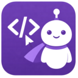
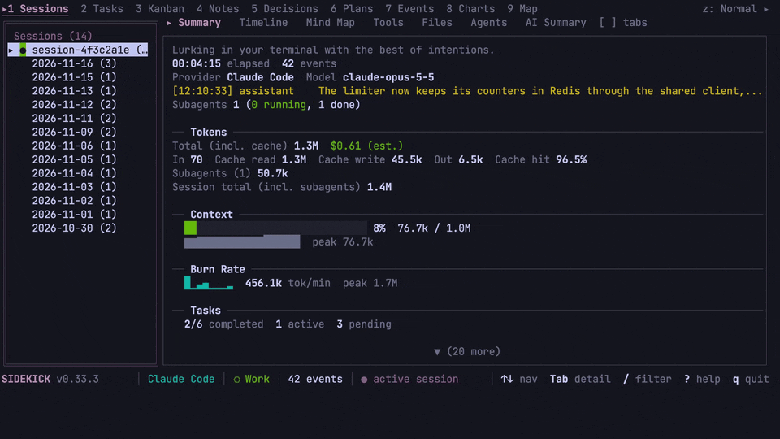
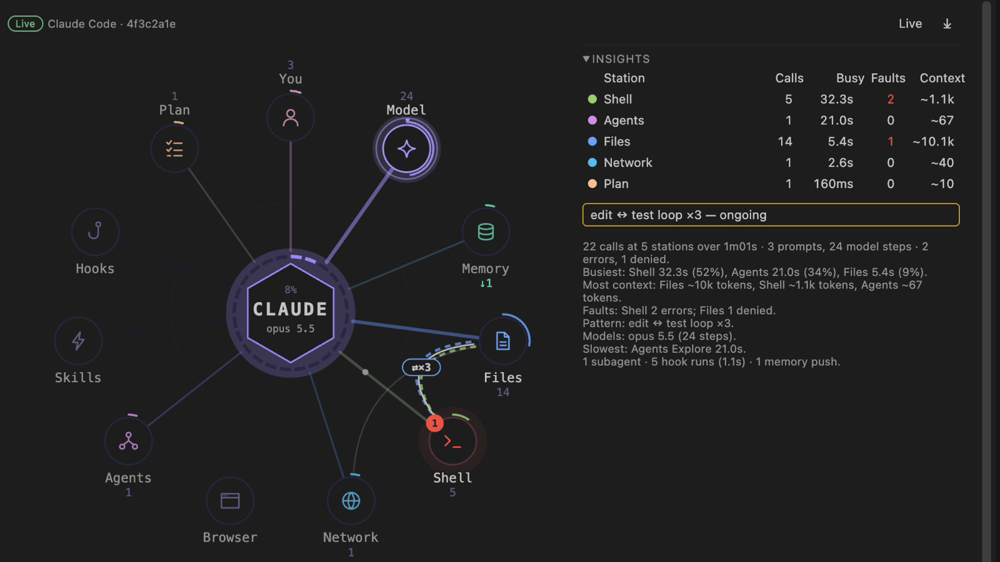
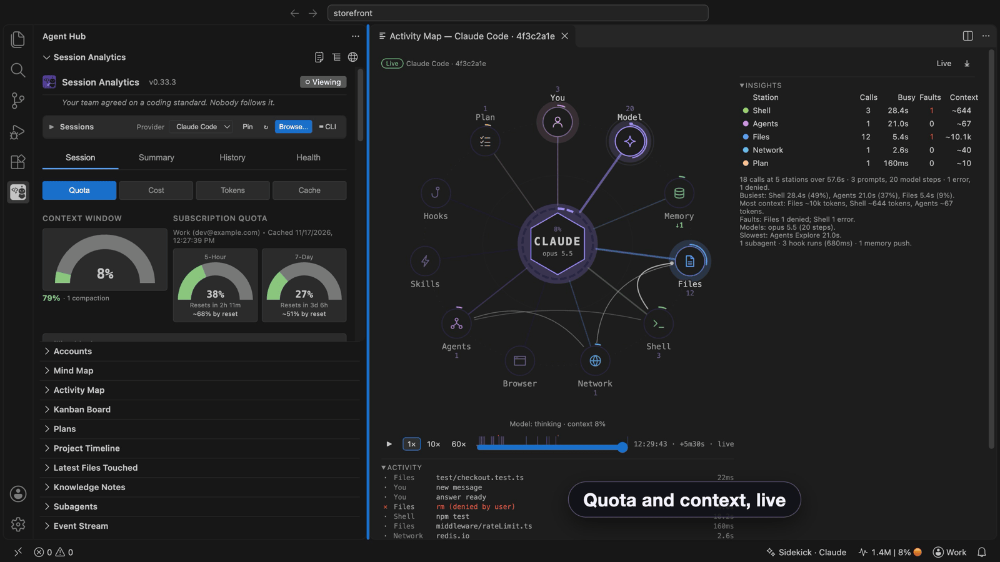
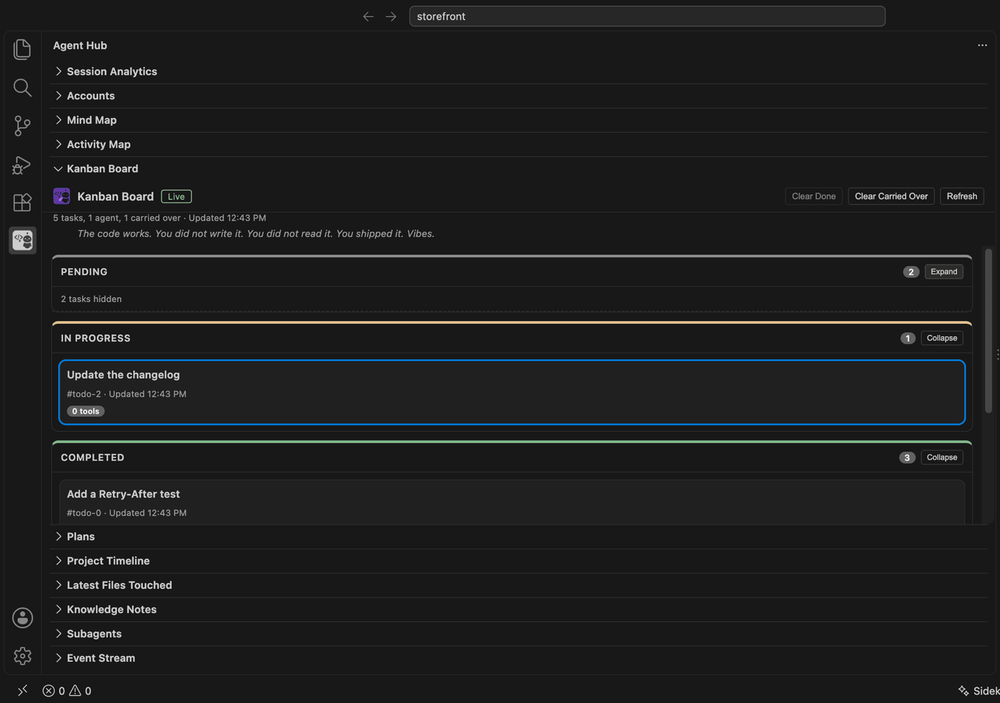
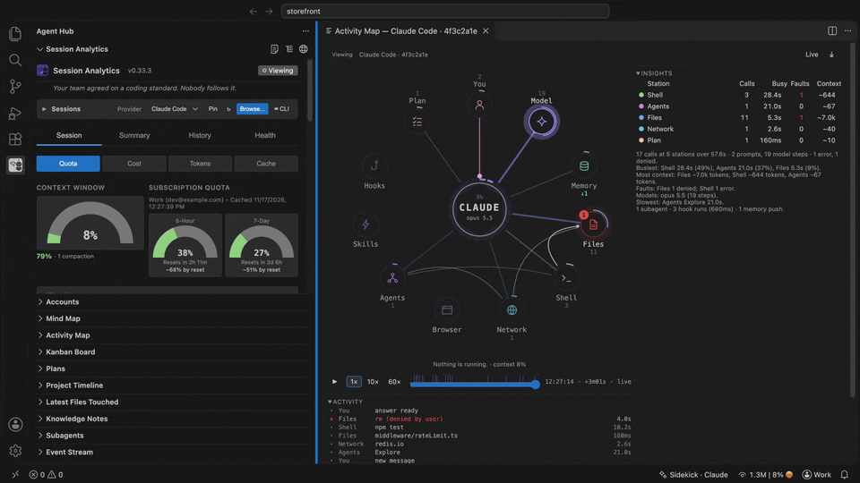
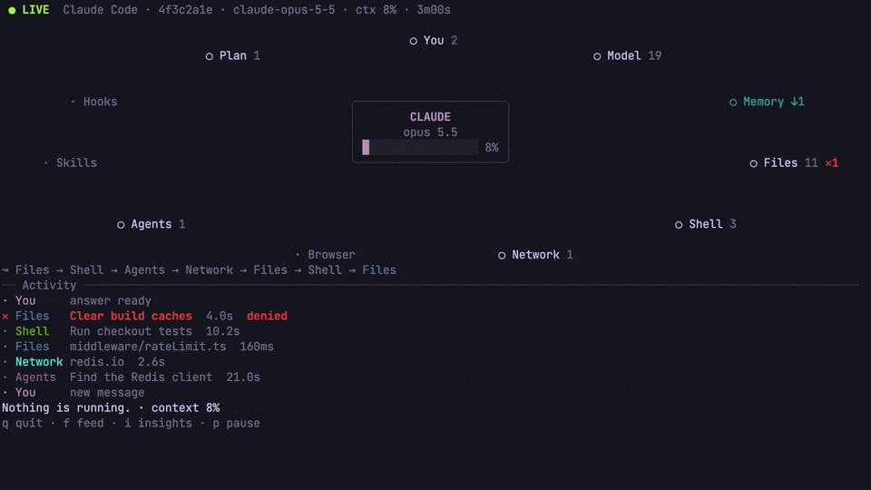

<p align="center">
  
</p>

<h1 align="center">Sidekick Agent Hub</h1>

<p align="center">
  <b>See what your AI coding agents are doing, and what they cost.</b><br>
  Live monitoring for Claude Code, Codex and OpenCode, in VS Code and in your terminal.
</p>

<p align="center">
  <a href="https://marketplace.visualstudio.com/items?itemName=CesarAndresLopez.sidekick-for-max"></a>
  <a href="https://open-vsx.org/extension/cesarandreslopez/sidekick-for-max"></a>
  <a href="https://www.npmjs.com/package/sidekick-agent-hub"></a>
  <a href="https://github.com/cesarandreslopez/sidekick-agent-hub/actions/workflows/ci.yml"></a>
  <a href="LICENSE"></a>
</p>

<p align="center">
  
</p>

Coding agents work out of sight. Tokens burn in the background, the context window fills up without warning, and when a session ends, what it learned is gone. Sidekick reads the session files your agent already writes and shows you:

- **What it's doing**: every tool call, file and subagent, live, on an activity map.
- **What it costs**: tokens, cost, context fill, plan quota and five-hour billing blocks.
- **What to keep**: tasks, decisions, notes and a handoff for the next session.

Monitoring needs no proxy and no wrapper: keep running `claude`, `codex` or `opencode` the way you do today.

## Install

**VS Code**: install **Sidekick Agent Hub** from the [VS Code Marketplace](https://marketplace.visualstudio.com/items?itemName=CesarAndresLopez.sidekick-for-max) or [Open VSX](https://open-vsx.org/extension/cesarandreslopez/sidekick-for-max), then open the **Agent Hub** icon in the activity bar.

**Terminal** (Node.js 20+; 22.15+ to read compressed Codex sessions):

```bash
npm install -g sidekick-agent-hub
sidekick dashboard
```

The npm package is `sidekick-agent-hub`; the command it installs is **`sidekick`**. Both products auto-detect your project and which agent you use.

## What you get

|                                                                                                                                                  See what it's doing                                                                                                                                                  |                                                                                                                                  Know what it costs                                                                                                                                   |                                                                                                                       Keep the context                                                                                                                       |
| :-------------------------------------------------------------------------------------------------------------------------------------------------------------------------------------------------------------------------------------------------------------------------------------------------------------------: | :-----------------------------------------------------------------------------------------------------------------------------------------------------------------------------------------------------------------------------------------------------------------------------------: | :----------------------------------------------------------------------------------------------------------------------------------------------------------------------------------------------------------------------------------------------------------: |
|                                                                                                                                                                                                                        |                                                                                                                                                                                               |                                                                                                                                                              |
| The **activity map** sends every tool call to one of eleven stations (files, shell, network, memory, browser, agents, skills, hooks, plan, model, you), with faults, subagents and the route the agent took. **Insights** show where the time, errors and context went and catch retry streaks and edit ↔ test loops. | **Tokens and cost** per session and model, **context fill**, your plan's **5-hour and weekly quota** with projections, the open **five-hour billing block** with its burn rate, and **usage reports** by day, week, month or session. Costs nothing could price read `—`, never `$0`. | **Tasks, decisions and knowledge notes** carry across sessions, a **handoff** summarises where you stopped, and **prompt history** finds what you asked before. The **project timeline**, **mind map** and **HTML report** let you go back over any session. |

## In VS Code

<p align="center">
  
</p>

The **Agent Hub** sidebar holds **Session Analytics** (quota, cost, tokens, cache, history and health), the **Activity Map** (open it in an editor tab to scrub and replay), **Accounts**, **Mind Map**, **Kanban Board**, **Plans**, **Project Timeline**, **Latest Files Touched**, **Knowledge Notes**, **Subagents** and **Event Stream**. The status bar shows the active account, tokens and context at a glance. See the [feature highlights](https://cesarandreslopez.github.io/sidekick-agent-hub/#feature-highlights).

## In the terminal

<p align="center">
  
</p>

`sidekick dashboard` is a full-screen view with nine panels (Sessions, Tasks, Kanban, Notes, Decisions, Plans, Events, Charts and Map). `sidekick map --follow` draws the live activity map in any terminal split. The one-shot commands work in scripts:

```bash
sidekick quota --all          # every provider's quota side by side (Claude, Codex, z.ai)
sidekick daily                # usage and cost from session logs (also weekly, monthly, sessions)
sidekick blocks               # five-hour billing blocks with burn rate and projections
sidekick report               # self-contained HTML session report
sidekick dump --prompts       # the prompts you typed, grouped by session (--all for every session of the project)
sidekick search "migration"   # search across sessions
sidekick doctor               # installation and session diagnostics
```

See the [CLI guide](https://cesarandreslopez.github.io/sidekick-agent-hub/features/cli/) for every command, option and keybinding.

## Accounts and quota

Sidekick registers the Claude Code and Codex logins you already use and switches between them without `/logout` cycles: `sidekick accounts` in the terminal, the **Accounts** view and status bar badge in VS Code. Switches are verified and can be undone, and every login keeps exactly one usable copy. Quota alerts fire once per threshold in each reset window, and in VS Code `sidekick.accounts.autoSwitchThreshold` switches to a healthier saved account when quota crosses it. See the [Account Switcher](https://cesarandreslopez.github.io/sidekick-agent-hub/features/account-switcher/) guide.

## For your agent

- **`sidekick mcp`** is a read-only facts server: register it with `claude mcp add sidekick -- sidekick mcp` or `codex mcp add sidekick -- sidekick mcp`, and the running agent can check its own quota, burn rate, context pressure, activity map and project notes. See [MCP](https://cesarandreslopez.github.io/sidekick-agent-hub/features/mcp/).
- **`sidekick statusline`** is a one-line footer for Claude Code (`"statusLine": { "type": "command", "command": "sidekick statusline" }` in `~/.claude/settings.json`). It also records the official rate limits Claude Code reports, so every other view shows authoritative quota.
- **`state.json`** in the Sidekick config folder is a public, versioned snapshot (account, quota, context, cost, billing block) for tmux bars, menu-bar apps and scripts.

## Also included

The VS Code extension can also run AI features through Claude Max, the Claude API, OpenCode or Codex: on-demand inline completions, code transforms, commit messages, PR descriptions, code review, explanations and inline chat. See the [docs](https://cesarandreslopez.github.io/sidekick-agent-hub/) for each.

## Providers

| Provider                                                                                                               | Inference | Session monitoring | Cost                        |
| ---------------------------------------------------------------------------------------------------------------------- | --------- | ------------------ | --------------------------- |
| **[Claude Max](https://cesarandreslopez.github.io/sidekick-agent-hub/providers/claude-max/)** (Pro, Max or Ultra plan) | Yes       | Yes (Claude Code)  | Included in subscription    |
| **[Claude API](https://cesarandreslopez.github.io/sidekick-agent-hub/providers/claude-api/)**                          | Yes       | —                  | Per-token billing           |
| **[OpenCode](https://cesarandreslopez.github.io/sidekick-agent-hub/providers/opencode/)**                              | Yes       | Yes                | Depends on provider         |
| **[Codex CLI](https://cesarandreslopez.github.io/sidekick-agent-hub/providers/codex/)**                                | Yes       | Yes                | ChatGPT plan or API billing |

> **OpenCode note:** DB-backed OpenCode session monitoring reads `opencode.db` and currently expects an executable `sqlite3` runtime in the host environment.

## Documentation

Full documentation is on the [docs site](https://cesarandreslopez.github.io/sidekick-agent-hub/):

- [Getting Started](https://cesarandreslopez.github.io/sidekick-agent-hub/getting-started/installation/) and [Provider Setup](https://cesarandreslopez.github.io/sidekick-agent-hub/getting-started/provider-setup/)
- [CLI Dashboard](https://cesarandreslopez.github.io/sidekick-agent-hub/features/cli/) and [Activity Map](https://cesarandreslopez.github.io/sidekick-agent-hub/features/activity-map/)
- [Configuration Reference](https://cesarandreslopez.github.io/sidekick-agent-hub/configuration/settings/)
- [Architecture](https://cesarandreslopez.github.io/sidekick-agent-hub/architecture/overview/)

## Why Am I Building This?

AI coding agents are the most transformative tools I've used in my career. They can scaffold entire features, debug problems across files, and handle the mechanical parts of software engineering that used to eat hours of every day.

But they're also opaque. Tokens burn in the background with no visibility. Context fills up silently until your agent starts forgetting things. And when a session ends, everything it learned — your architecture, your conventions, the decisions you made together — is just gone. The next session starts from zero.

That bothers me. I want to see what my agent is doing. I want to review every tool call, understand where my tokens went, and carry context forward instead of losing it. Sidekick exists because I think the people using these agents deserve visibility into how they work — not just the output, but the process.

## Contributing

Contributions are welcome! See [CONTRIBUTING.md](CONTRIBUTING.md) for setup instructions and guidelines. The README demos are recorded by a script in [`demo/`](demo/README.md).

## See Also

**[sidekick-shared](https://www.npmjs.com/package/sidekick-shared)** — the data access library behind both products, published on npm: session providers and parsers, usage and pricing, quota, the activity map, Zod schemas and more, for building your own tools on Sidekick's session data. Install with `npm install sidekick-shared`.

**[Sidekick Docker](https://github.com/cesarandreslopez/sidekick-docker)** — a sibling project that brings the same real-time dashboard experience to Docker management. Monitor containers, Compose projects, images, volumes, and networks from a keyboard-driven TUI or VS Code panel. Available as a [VS Code extension](https://marketplace.visualstudio.com/items?itemName=CesarAndresLopez.sidekick-docker-vscode), [Open VSX extension](https://open-vsx.org/extension/CesarAndresLopez/sidekick-docker-vscode), and [CLI](https://www.npmjs.com/package/sidekick-docker).

## Community

If Sidekick is useful to you, a [star on GitHub](https://github.com/cesarandreslopez/sidekick-agent-hub) helps others find it.

Found a bug or have a feature idea? [Open an issue](https://github.com/cesarandreslopez/sidekick-agent-hub/issues) — all feedback is welcome.

## Acknowledgements

The **session asset extraction** feature — the `Sidekick: Extract Session Assets` VS Code command and the `sidekick extract` CLI command — was contributed by **[Juan Fourie (@B33pBeeps)](https://github.com/B33pBeeps)** in [#17](https://github.com/cesarandreslopez/sidekick-agent-hub/pull/17), adapted from his MIT-licensed [`trawl`](https://github.com/B33pBeeps/trawl) project. Thank you, Juan! See [CONTRIBUTORS.md](CONTRIBUTORS.md) and [THIRD_PARTY_NOTICES.md](THIRD_PARTY_NOTICES.md) for details.

## License

MIT — see [LICENSE](LICENSE). Portions of the session asset extraction feature are adapted from the MIT-licensed [`trawl`](https://github.com/B33pBeeps/trawl); see [THIRD_PARTY_NOTICES.md](THIRD_PARTY_NOTICES.md).

---

Latest release: **0.33.4**. See the [changelog](CHANGELOG.md) for every release.
