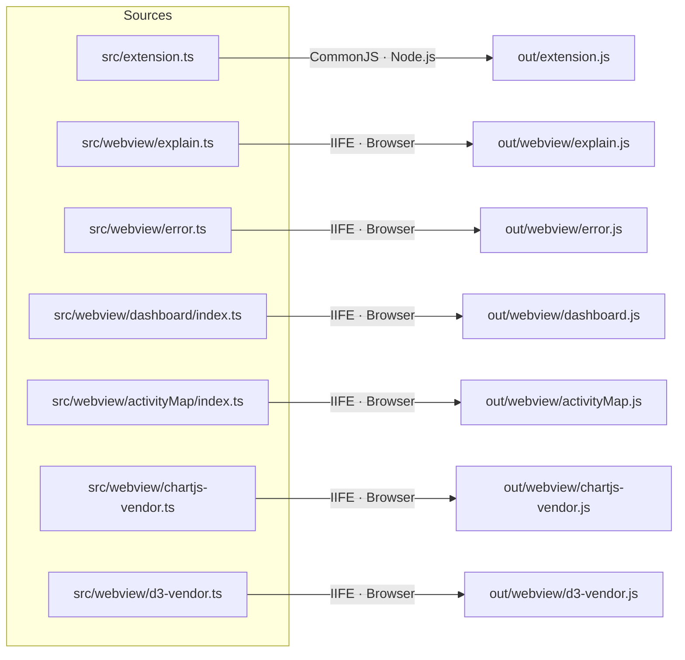
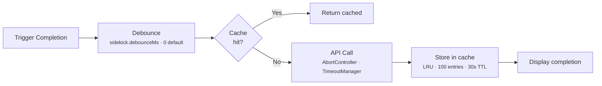

# Architecture Overview

## Build System (esbuild)

The VS Code extension build (`sidekick-vscode/esbuild.js`) produces seven esbuild bundles. The dashboard's script is bundled from `src/webview/dashboard/` and receives its initial data through an embedded JSON block, so the document `DashboardViewProvider` renders contains no inline executable script.

Only `vscode` is externalized from the extension-host bundle. Other extension dependencies (including `@anthropic-ai/claude-agent-sdk`, `@opencode-ai/sdk`, and `sidekick-shared`) are bundled by esbuild; the `conditions: ['import']`, `banner`, and `define` settings polyfill `import.meta.url` for ES-module dependencies bundled into CommonJS. Chart.js and D3.js are bundled into local browser vendor files so the dashboard and mind map work offline. The Activity Map webview imports only `sidekick-shared/activity` plus `formatTokenCount` from `sidekick-shared/browser` (the recorder is tree-shaken out; about 63 KiB minified) and draws the shared SVG themed through CSS variables.

## Entry Points

- **Extension**: `sidekick-vscode/src/extension.ts` contains the `activate()` function, which registers all commands, providers, and services.
- **CLI**: `sidekick-cli/src/entry.ts` answers `sidekick statusline` without loading the rest of the CLI and otherwise imports the main bundle; `sidekick-cli/src/cli.ts` registers the Commander commands, which are implemented in `sidekick-cli/src/commands/`.

## Package Structure

| Package            | Purpose                                                                                                                  | Build   |
| ------------------ | ------------------------------------------------------------------------------------------------------------------------ | ------- |
| `sidekick-vscode/` | VS Code extension (UI, monitoring, inference)                                                                            | esbuild |
| `sidekick-shared/` | Pure TS library — readers, types, session providers, schemas, extractors, model pricing, quota polling (no VS Code deps) | tsc     |
| `sidekick-cli/`    | CLI binary — dashboard, one-shot commands, markdown/JSON output                                                          | esbuild |

[`sidekick-shared`](https://www.npmjs.com/package/sidekick-shared) holds the data access layer shared by the extension and the CLI, and is published as a standalone npm package (`npm install sidekick-shared`) with no VS Code dependencies. It contains the canonical session providers and the `createSessionProviders()` factory (constructors do no environment I/O; unavailable providers are reported as structured diagnostics), Zod schemas for runtime validation, a typed `JsonlParser`, pure extractors (`extractTokenUsage`, `extractToolCalls`), model info and pricing with normalized, non-double-counting usage cost (`normalizeProviderUsage`, `calculateNormalizedUsageCost`, `priceProviderUsage`), token estimation, transcript projection and reads (`projectSessionTranscript`, `listRecentSessions`, `readSessionTranscript`), the UI-independent `SessionMonitor` and the fingerprint-cached `ObservedSessionCollector`, actionable asset extraction (`gatherAssetsForCwd`), and quota polling (`QuotaPoller`, plus `MultiProviderQuotaService` and `CodexQuotaWatcher`, which stay dormant until a matching account exists and wake through `onAccountsChanged()`).

### Public entry points

`sidekick-shared` publishes these entry points through its `package.json` `exports` map. Pick the narrowest one that covers what you need and matches your runtime.

Main entries:

- `sidekick-shared` — the full Node API, used by the extension host and the CLI.
- `sidekick-shared/node` — Node only: pricing-catalog and context-window hydration, the observed context-window store, transcript and history reads, session previews, prompt history, usage events (`collectUsageEvents()` with `createSessionProviders()`), and observed-session collection, without loading the root barrel.
- `sidekick-shared/browser` — pure, filesystem-free helpers for webviews and browser bundles: usage normalization and cost math, token estimation, transcript and assistant-turn projection, model and context-window math. Webview code must not import the package root or `/node`.

Dedicated entries:

- `sidekick-shared/schemas` — the Zod boundary schemas, with no filesystem or Node built-ins, for validating data at process and IPC edges.
- `sidekick-shared/statusline` (Node) — the cache-only status-line surface behind `sidekick statusline`: formatter, account and quota-snapshot readers, burn-rate estimates, and `state.json` reading and writing.
- `sidekick-shared/testing` (Node test runners) — the credential guard that keeps tests away from real agent homes and binaries, plus session-log fixture builders.

Lean subpaths that run anywhere:

- `phrases`, `modelContext`, `modelInfo`, `formatting` — phrase arrays, the context-window module, model parsing and cost math, and cost/token/duration display helpers.
- `pricing`, `tokenEstimation` — model pricing and usage cost without Zod; a single-module token estimator.
- `providerFailure`, `providerIds`, `handoffUrl`, `statusline/payload` — single-purpose pure modules.
- `headless` — parsers for `claude -p` stream-json and `codex exec --json` output.
- `activity` — the activity map recorder, layout, and SVG renderer.

Lean subpaths for Node only:

- `codex` — Codex homes, `auth.json` helpers, and rollout lookup.
- `agentPaths` — agent homes and transcript-path classification using only `fs`, `os`, and `path`, for hook-sized bundles.
- `pricingHydration` — LiteLLM catalog hydration and the observed context-window store without the `/node` graph.

Every subpath also has a `module` condition that points at an ES-module build in `dist/esm/`, which bundlers tree-shake; Node keeps loading the CommonJS build. `sidekick-shared/dist/*` deep imports still resolve for compatibility, but prefer the entries above. The [`sidekick-shared` README](https://github.com/cesarandreslopez/sidekick-agent-hub/blob/main/sidekick-shared/README.md#supported-import-paths) lists what each one exports.

## Key Source Locations

| Area                        | Location                                                                                                                                                                                                                                                                     |
| --------------------------- | ---------------------------------------------------------------------------------------------------------------------------------------------------------------------------------------------------------------------------------------------------------------------------- |
| Extension entry point       | `sidekick-vscode/src/extension.ts`                                                                                                                                                                                                                                           |
| Extension core types        | `sidekick-vscode/src/types.ts` (`ClaudeClient`, `CompletionOptions`), `sidekick-vscode/src/types/`                                                                                                                                                                           |
| Prompt templates            | `sidekick-vscode/src/utils/prompts.ts`, `analysisPrompts.ts`, `summaryPrompts.ts`                                                                                                                                                                                            |
| Inference clients           | `sidekick-vscode/src/services/AuthService.ts`, `MaxSubscriptionClient.ts`, `ApiKeyClient.ts`, `OpenCodeClient.ts`, `CodexClient.ts`                                                                                                                                          |
| Canonical session providers | `sidekick-shared/src/providers/claudeCode.ts`, `openCode.ts`, `codex.ts`, with `factory.ts`, `detect.ts`, and `types.ts` alongside                                                                                                                                           |
| VS Code provider adapters   | `sidekick-vscode/src/services/providers/ClaudeCodeSessionProvider.ts`, `OpenCodeSessionProvider.ts`, `CodexSessionProvider.ts`                                                                                                                                               |
| Shared public entries       | `sidekick-shared/src/index.ts`, `browser.ts`, `node.ts`, `schemas/index.ts`, `statusline/index.ts`                                                                                                                                                                           |
| Shared session pipeline     | `sidekick-shared/src/types/sessionEvent.ts`, `sessionMonitor.ts`, `observedSessionCollector.ts`, `sessionTranscripts.ts`, `sessionPreviews.ts`                                                                                                                               |
| CLI entry points            | `sidekick-cli/src/entry.ts` (fast status-line dispatch), `sidekick-cli/src/cli.ts` (Commander registration), `sidekick-cli/src/commands/`                                                                                                                                    |
| Webview UI                  | `sidekick-vscode/src/webview/` (vanilla TS, bundled as IIFE)                                                                                                                                                                                                                 |
| Dashboard                   | `sidekick-vscode/src/providers/dashboardTemplate.ts` (markup) and `dashboardStyles.ts` (CSS); behaviour in `sidekick-vscode/src/webview/dashboard/`, where `legacy.ts` is the still-untyped script moved out of the old inline template and new features go in typed modules |
| Session analysis            | `sidekick-vscode/src/services/SessionAnalyzer.ts`, `sidekick-vscode/src/utils/cycleDetector.ts`                                                                                                                                                                              |

## Request Management

Inline completions are on demand. `InlineCompletionProvider` answers only explicit triggers (**Sidekick: Trigger Completion**, `Ctrl+K Ctrl+Shift+Space` or `Cmd+K Cmd+Shift+Space` on macOS) and ignores typing; `CompletionService` handles the request.

- **Debouncing**: `sidekick.debounceMs` (default 0) delays a triggered request; a newer trigger inside the window replaces the pending one
- **LRU cache**: `CompletionCache` — 100 entries, 30s TTL
- **Cancellation**: `AbortController` linked through `CompletionOptions.signal`
- **Timeouts**: `TimeoutManager` provides per-operation timeouts with context-size scaling

## Persistence

Cross-session data lives in one config directory. `getConfigDir()` resolves it in this order: a `setConfigDir()` override, then the `SIDEKICK_CONFIG_DIR` environment variable, then the platform default (`~/.config/sidekick/` on Unix, `%APPDATA%/sidekick/` on Windows). Every `sidekick-shared` reader and writer, the CLI, and the extension's own stores resolve through it, so the override relocates all of them together. Paths below are relative to that directory.

| Path                                           | Purpose                                                                                                                                                                                                                                    |
| ---------------------------------------------- | ------------------------------------------------------------------------------------------------------------------------------------------------------------------------------------------------------------------------------------------ |
| `historical-data.json`                         | Token/cost/tool usage stats and bounded per-session history with provider and project dimensions (schema v3)                                                                                                                               |
| `tasks/{projectSlug}.json`                     | Kanban board carry-over                                                                                                                                                                                                                    |
| `decisions/{projectSlug}.json`                 | Decision log                                                                                                                                                                                                                               |
| `plans/{projectSlug}.json`                     | Plan history shown in the Plan Board                                                                                                                                                                                                       |
| `knowledge-notes/{projectSlug}.json`           | Knowledge notes per project                                                                                                                                                                                                                |
| `notifications/{projectSlug}.json`             | Fired notifications kept across extension reloads                                                                                                                                                                                          |
| `handoffs/`                                    | Latest (`{projectSlug}-latest.md`) and timestamped session handoff documents                                                                                                                                                               |
| `event-logs/`                                  | Optional JSONL session audit logs                                                                                                                                                                                                          |
| `error-history.json`                           | Categorized per-session error rollups for post-mortem forensics                                                                                                                                                                            |
| `accounts/accounts.json`                       | Provider-aware account registry (Claude Code and Codex)                                                                                                                                                                                    |
| `accounts/credentials/<uuid>.credentials.json` | Private Claude credential backups that Claude Code never reads                                                                                                                                                                             |
| `accounts/claude/credential-homes.json`        | Ledger of every directory Sidekick put a Claude credential in, used by `sidekick accounts doctor`                                                                                                                                          |
| `accounts/claude/switch-journal.json`          | Present only while a Claude account switch is in flight                                                                                                                                                                                    |
| `accounts/codex/`                              | Codex account backups (`backups/<id>.auth.json`), isolated profile homes, and a `switch-journal.json` while a switch is in flight                                                                                                          |
| `quota-snapshots.json`                         | Last quota snapshot per provider and account, for offline fallback                                                                                                                                                                         |
| `quota-history/`                               | Quota samples per workspace and provider (`{workspaceId}/{provider}.jsonl`)                                                                                                                                                                |
| `snapshots/`                                   | Cached session aggregation snapshots that let a dashboard resume a session without a full replay                                                                                                                                           |
| `pricing-catalog.json`                         | Cached LiteLLM catalog — prices and context window sizes (24h TTL, auto-refreshed on activation)                                                                                                                                           |
| `observed-context-windows.json`                | Context windows a provider actually reported, per model; outranks the catalog's published maximum                                                                                                                                          |
| `usage-cache/`                                 | Per-session usage events extracted from session logs (Claude Code subagent transcripts included), keyed by size and mtime; feeds `sidekick blocks`, `sidekick daily`/`weekly`/`monthly`/`sessions`, and the dashboards' billing-block card |
| `state.json`                                   | Public, versioned (`schemaVersion: 1`) snapshot for external tools: account, quota windows with freshness, context usage, session cost, active billing block; written by the status line and both dashboards only when changed             |
| `cli-config.json`                              | CLI preferences, including dashboard settings and custom model prices                                                                                                                                                                      |
| `update-check.json`                            | Cached result of the CLI's update check                                                                                                                                                                                                    |

The Sidekick CLI reads these same files, giving terminal access to persisted data without VS Code. It also writes to them: `sidekick tasks add` / `tasks done`, `note add`, `decision add`, and `import` merge into the same stores through the shared atomic writers. New storage code should use the shared path helpers and atomic writers rather than hardcoding the default directory.
