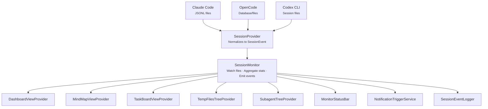

# Session Monitoring Pipeline

The session monitoring system follows a pipeline architecture from raw CLI data to UI.

## Pipeline Flow

## SessionProvider

Each CLI agent stores session data differently. Canonical implementations in `sidekick-shared/src/providers/` normalize raw data into `SessionEvent`, defined in `sidekick-shared/src/types/sessionEvent.ts`. The extension classes in `sidekick-vscode/src/services/providers/` are thin adapters; `ClaudeSessionEvent` remains a compatibility alias.

| Provider    | Data Source                                                                                                                                    | Format                          |
| ----------- | ---------------------------------------------------------------------------------------------------------------------------------------------- | ------------------------------- |
| Claude Code | `~/.claude/projects/` (`$CLAUDE_CONFIG_DIR/projects/` when set)                                                                                | JSONL files                     |
| OpenCode    | OpenCode data dir (`~/.local/share/opencode/`, `~/Library/Application Support/opencode/`, `%LOCALAPPDATA%\opencode\` or `%APPDATA%\opencode\`) | `opencode.db` plus legacy files |
| Codex CLI   | `~/.codex/sessions/` and `~/.codex/archived_sessions/`                                                                                         | Session files                   |

## SessionMonitor

The `SessionMonitor` class:

1. Watches session files with filesystem notifications and catch-up polling; database readers poll for changes
2. Reads canonical events through the selected provider, with complete-line buffering for JSONL
3. Aggregates statistics (tokens, costs, tool usage)
4. Runs detection systems on incoming events (truncation, context health, goal gates, cycles)
5. Emits typed events consumed by UI components

### Checkpoints and recovery

Claude Code and Codex dashboards save a matching aggregation snapshot and complete-line reader position after delivered batches. Restores validate the aggregation schema and dashboard format; incompatible snapshots trigger replay. Codex seeking reconstructs parser context, and partial UTF-8 records remain buffered until complete. CLI snapshots require complete history: live-only sessions never overwrite a replay checkpoint, and session switches reset eligibility.

Since 0.32 both dashboards also keep the session's [activity map](../features/activity-map.md) log: the shared activity recorder runs on every normalized event (replayed or live), and its state and records are saved in the same checkpoint (VS Code and CLI checkpoint revision 6), because a resumed reader never sees the bytes it skips. A checkpoint without them, or one whose activity log was trimmed, is refused and the session replays once. Claude Code readers in both dashboards are created with `includeActivitySignals`, so hook outcomes and pushed memory reach the recorder as `system` events that the aggregator and the dashboards' own timelines skip.

OpenCode dashboard snapshots are bypassed because a SQLite timestamp alone cannot restore row-version deduplication. Reopening with history enabled performs a full replay; explicit CLI live-only mode still follows only new activity. VS Code stop/resume preserves the monitor's subscriptions and selected folder.

### Detection Systems

Four detection systems run inline as events arrive:

| System                   | Trigger            | Output                                                                               |
| ------------------------ | ------------------ | ------------------------------------------------------------------------------------ |
| **Truncation Detection** | Every tool result  | Scans for 6 truncation markers, records per-tool counts, fires `_onTruncation` event |
| **Context Health**       | Compaction events  | Calculates fidelity score from compaction count and reclaimed percentage             |
| **Goal Gate Detection**  | Task create/update | Flags tasks matching critical keywords or blocking 3+ other tasks                    |
| **Cycle Detection**      | Every tool call    | Sliding-window signature hashing via `cycleDetector.ts`, throttled to 60s intervals  |

These systems feed their results into the dashboard, handoffs, notifications, mind map, and knowledge note candidate extraction.

## UI Consumers

| Consumer                     | Purpose                                 |
| ---------------------------- | --------------------------------------- |
| `DashboardViewProvider`      | Token usage, costs, timeline, analytics |
| `MindMapViewProvider`        | D3.js session structure graph           |
| `TaskBoardViewProvider`      | Kanban board with task/agent tracking   |
| `TempFilesTreeProvider`      | Files modified during session           |
| `SubagentTreeProvider`       | Spawned agent monitoring                |
| `MonitorStatusBar`           | Status bar metrics                      |
| `NotificationTriggerService` | Alert system                            |
| `SessionEventLogger`         | Optional JSONL audit trail              |

## CLI Reader Path

The [`sidekick-shared`](https://www.npmjs.com/package/sidekick-shared) library supplies both the CLI dashboard's live watchers and one-shot readers for history, reports, and context. Shared writers also support CLI task, note, decision, and history-import commands. Third-party tools can consume the same library directly (`npm install sidekick-shared`).

Codex sessions flow through the same canonical path as the other providers: a `ProviderReaderSessionWatcher` (or a one-shot reader) yields canonical `SessionEvent`s, and `parseTranscriptFromEvents()` turns those into the transcript used by the dashboard, reports, and project timeline. This keeps the CLI and the VS Code extension rendering identical evidence for a given session.

### Canonical usage and transcript projection

Provider readers normalize usage before aggregation. Claude/Anthropic cache categories are additive; Codex/OpenAI cached input is removed from the uncached-input category, and reasoning that is already included in output remains visible without being counted or priced twice. Unknown pricing remains unpriced rather than appearing as zero. The browser-safe `projectSessionTranscript()` consumes those same canonical events; Node consumers use `listRecentSessions()` and `readSessionTranscript()` so history does not need another JSONL parser hierarchy. Each projected message retains provider provenance on `source` — entrypoint, meta/sidechain flags, original role, cwd, and git branch — so consumers can distinguish human prompts from orchestration without reparsing JSONL. Claude Code messages also keep `isCompactSummary`, `originKind`, and `promptSource`, and `isHumanPrompt()` / `humanPromptText()` apply the shared human-prompt rule. As of 0.27.0 the Node-only `collectPromptHistory()` uses that rule to extract typed prompts for a set of workspace roots, with fail-closed cwd scoping, stable per-session ordinals, a byte-offset cursor, and bounds reported in `boundsHit`. As of 0.27.1 a prompt collected before its answer is written keeps a replay offset in the cursor (no prompt text) and is returned again under the same identity whenever its model, usage, or `metadataStatus` changes (for example when its first answering call's model and usage arrive); `metadataStatus` marks entries `pending`, `provisional`, or `final`. As of 0.27.2 files are streamed in fixed-size chunks and every pass stops after a complete line: a per-file byte budget (`maxFileBytes`) and call-wide byte, session, entry, and time budgets stop the pass without losing what was read, the version 3 cursor continues each file from where it stopped (with `next` rotating the starting file so no session is starved), and `hasMore` says whether another call would read more. A pending prompt carries its answer state (first-answer message id, model, and usage, no text) instead of a replay window, so an answer written any distance after its prompt still settles it. Records over `maxRecordBytes` and malformed lines are the only permanent exclusions and are reported in `exclusions`. The cursor is sensitive local state: its keys are path-free, but Codex resume state holds the session's cwd. As of 0.27.5, `collectSessionPromptHistory()` reads the same logs whole, with the same scanners, and groups the prompts by session for classifying entire sessions. Opt-in `include` adds each prompt's final reply and interaction signals (interrupts, rejected or failed tools, compactions, API errors, rollbacks). Sessions that a bound interrupts, or that change while being read, are listed in `unread` instead of being returned partially. `sidekick dump --prompts` exposes it on the command line. As of 0.31.0 the rules both collectors share, along with usage events' `promptOrdinal` and tool-call origins, are versioned as `PROMPT_ORDINAL_SCHEME_VERSION` and pinned by golden Claude Code and Codex fixtures. Failed-tool signals carry `command`, `output` (the end of the output, where errors are), `exitCode` and `toolUseId`.

As of 0.31.0, scope works the same way across collectors. `collectUsageEvents({ workspacePaths })` keeps only sessions whose recorded cwd resolves to a root or inside one (`scope: 'contained'`), as prompt history does, and workspace roots expand to every worktree that `resolveGitWorktrees()` reads from git's own files, including bare and `--separate-git-dir` layouts. Every collector also accepts explicit agent `homes` instead of the process environment, and `listAgentSessions()` lists each provider once for several collectors. Usage collection can be bounded and resumed with a cursor that returns only the sessions that changed, and subagent usage carries `parentPromptOrdinal`, the top-level prompt the subagent started under. Directory listings re-stat every file, so a host that reuses its providers keeps up with a session that is still growing. The Codex reader emits turn-lifecycle `system` events, which `classifyTurnState()` and the activity detector use to tell a finished turn from a running one.

As of 0.33.1, no async collector blocks its host for a whole session. The Claude Code and Codex readers read in slices of at most 1 MiB and offer `readNewBounded(maxBytes)`, which reads a session in bounded steps whose events equal one `readNew()`. `collectUsageEvents()`, `importSessionHistory()`, `searchSessions()` (through `searchInSessionAsync()`), the observed-session adapter, and the VS Code monitor's replay read in steps and yield to the event loop between them. `collectUsageEvents()` checks its deadline and abort signal between steps, too. With the cache on, a session it stops partway leaves its progress in a partial cache entry (offset, reader state, file identity and usage so far, per transcript), and the next call continues it, so a result never holds part of a session. Compressed Codex rollouts decompress on the libuv thread pool in the async paths.

`ObservedSessionCollector` adds host-scheduled collection around the provider adapters. Provider-backed sources from `observedSessionSourceFromProvider()` expose the adapter's `ProviderCapabilitiesV1` record. Provider discovery and each session read fail independently, with bounded retry backoff, fingerprint-change bypass, duplicate-failure suppression, and observable recovery. `collect()` deliberately does not own timers, logging sinks, UI events, or product-specific control/session projection; the opt-in `subscribe()` (0.25.0) is the exception, owning its own debounce, filesystem-watch, and catch-up-poll timers to deliver coalesced change batches, while parses stay fingerprint-cached so unchanged sessions cost no content reads. As of 0.26.5 a watch event is reconciled with one stat through the provider's `statWatchedSessionFile()`; a full `discover()` runs only for unknown paths, catch-up polls, and the initial pass, at most once per `minReconcileGapMs`. Claude Code and Codex enumerate through a per-instance directory-listing cache (one stat per unchanged directory), the parse cache is bounded by `maxCacheEntries` / `maxCacheBytes`, and `discover({ limit, since })` / `collect({ limit, since })` bound a pass for hosts over large histories.

### Session context evidence snapshots

On top of the reader path, `buildSessionContextSnapshot()` / `readSessionContextSnapshot()` project a provider-neutral view of what an assistant has "seen" in a session — layered evidence sources (system, user prompts, tool inputs/outputs, thinking), a low/medium/high **context pressure** band, and observed **capabilities** (tools, MCP servers, permission mode, rate limits). `createSessionContextProjector()` builds the snapshot incrementally as new events stream in. Every session provider exposes `readSessionContextSnapshot()`.
