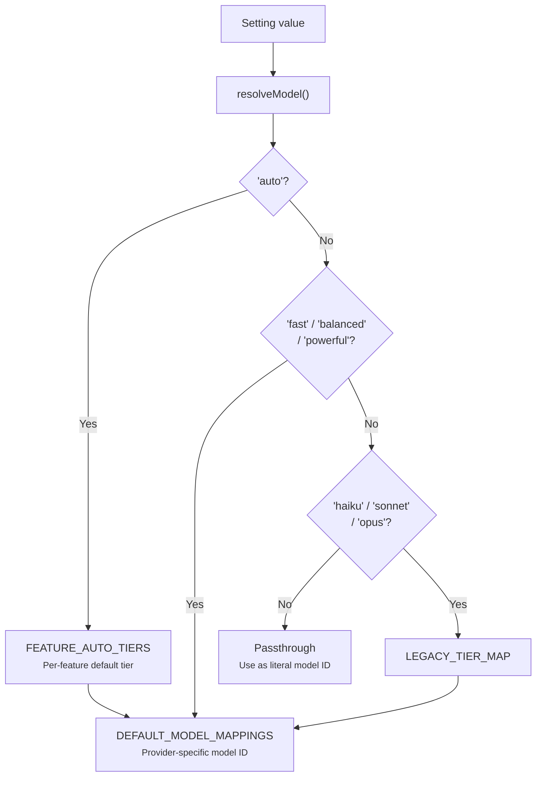

# Model Resolution

Sidekick uses a tier-based model resolution system that maps abstract tiers to provider-specific model IDs.

## Resolution Flow

## Tiers

| Tier       | Use Case                                               | Claude Model | Codex Model   |
| ---------- | ------------------------------------------------------ | ------------ | ------------- |
| `fast`     | Low latency, frequent calls (inline completions, docs) | Haiku 5.5    | `gpt-6-luna`  |
| `balanced` | Quality/speed tradeoff (explanations, commits, review) | Sonnet 5.5   | `gpt-6.1-sol` |
| `powerful` | Highest quality (code transforms)                      | Opus 5.5     | `gpt-6-astra` |

The Claude column resolves per inference provider: `claude-max` passes the short
names (`haiku` / `sonnet` / `opus`) to the CLI, while `claude-api` and `opencode`
resolve to versioned IDs (`claude-haiku-5-5`, `claude-sonnet-5-5`,
`claude-opus-5-5`, with an `anthropic/` prefix for OpenCode). Native Claude
aliases follow the installed CLI's model mapping.

These defaults were reviewed on November 11, 2026 against the
[Anthropic model overview](https://platform.claude.com/docs/en/models/overview)
and [OpenAI model guidance](https://developers.openai.com/api/docs/guides/latest-model).
Opus 5.5 stays the powerful default: Fable 5.2 costs twice as much and its
turns can run for minutes.

## Per-Feature Defaults

When a model setting is `"auto"`, it resolves to the recommended tier for that
feature. Each feature also asks for an effort (see
[Request Tuning](#request-tuning)), whatever model it resolves to:

| Feature            | Default Tier | Effort  |
| ------------------ | ------------ | ------- |
| Inline completions | fast         | minimal |
| Documentation      | fast         | low     |
| Code transforms    | powerful     | medium  |
| Commit messages    | balanced     | minimal |
| Explanations       | balanced     | low     |
| Error analysis     | balanced     | low     |
| Inline chat        | balanced     | low     |
| Code review        | balanced     | medium  |
| PR descriptions    | balanced     | low     |

## Request Tuning

Current models think by default and differ in what they accept, so the
inference clients send per-model settings rather than one fixed request:

| Model                   | `minimal` effort                       | `low` / `medium` effort                   |
| ----------------------- | -------------------------------------- | ----------------------------------------- |
| Haiku 5.5               | thinking `disabled`, effort `low`      | `output_config.effort`, `max_tokens` room |
| Sonnet 5.5              | thinking `between_tools`, effort `low` | `output_config.effort`, `max_tokens` room |
| Sonnet 5, Opus 5        | thinking `disabled`, effort `low`      | `output_config.effort`, `max_tokens` room |
| Opus 5.5, Fable, Mythos | thinking stays on: effort `low`, room  | `output_config.effort`, `max_tokens` room |
| Claude 4.x and older    | unchanged request                      | unchanged request                         |

Thinking tokens count against `max_tokens`, so a model that may think gets up
to 2,048 (low) or 8,192 (medium) extra tokens, capped at 16,000. No request
sends `temperature`, `top_p`, `top_k`, or `budget_tokens`, which the 5.x
models reject.

- **Claude API** (`claude-api`): the table above. A request without an effort
  still gets `low`, so a small `max_tokens` cannot be spent entirely on
  thinking. A refusal (`stop_reason: refusal`) is reported as an error.
- **Claude Max** (`claude-max`): Claude Code's own effort level (`low`, or
  `medium` for review and transforms).
- **Codex**: `-c model_reasoning_effort="low"` (or `"medium"`). `low` is the
  floor: GPT-6.1 Sol and GPT-6 Astra reject `none`.
- **OpenCode**: no change; OpenCode's own provider settings apply.

## Legacy Names

For backward compatibility, legacy Claude model names are mapped to tiers:

| Legacy Name | Maps To  |
| ----------- | -------- |
| `haiku`     | fast     |
| `sonnet`    | balanced |
| `opus`      | powerful |

## Literal Model IDs

You can bypass the tier system entirely by setting a full model ID (e.g., `claude-sonnet-5-5` or `gpt-6.1-terra`). This is passed directly to the provider without any mapping.

Use `claude-fable-5-2` for Anthropic's most capable widely released model
($8 / $40 per million input/output tokens) when your provider account supports
it; a literal `fable` also works (Claude Max passes it to Claude Code, the API
client maps it to `claude-fable-5-2`). `claude-mythos-5-2` is the same model
for organizations verified through Anthropic's access programs. Fable and
Mythos require 30-day data retention, so zero-data-retention organizations
cannot use them.

To keep the previous defaults, set `claude-haiku-4-5`, `claude-sonnet-5`, or
`gpt-6-sol` explicitly. The GPT-6 Codex tiers need a Codex CLI that offers
`gpt-6-luna` and `gpt-6.1-sol`; on an older CLI, set a literal ID such as
`gpt-6-sol` or `gpt-5.6-terra`.

## CLI Dashboard Summaries

The CLI dashboard has separate inference defaults for its short session
summaries. Direct Anthropic API calls use `claude-haiku-5-5` with thinking
disabled and low effort; direct OpenAI API calls use `gpt-6-luna` with
reasoning effort `none` and a 1,024-token completion limit. Summaries
generated through `claude --print` or `codex exec` inherit the native CLI's
model configuration.

## Pricing and Context Metadata

The shared model catalog supplies cost estimates and context gauges to the CLI
and VS Code. Catalog hydration reuses cached LiteLLM data for up to 24 hours,
then attempts a refresh. Bundled metadata covers models missing from the catalog. Observed context windows
take precedence over published limits when they match the same model, so a
provider's effective account limit can be smaller than the published maximum.
Quota utilization comes from separate provider APIs or local samples.

### Long-context price tiers

Some models bill a whole request at higher rates once its prompt passes a
threshold: GPT-5.4 and later and the GPT-6 family above 272,000 prompt tokens
(input ×2, output ×1.5, cache reads ×2), Haiku 5.5 above 100,000 (×5). The
prompt is uncached input plus cache reads plus cache writes, and the request
must be strictly above the threshold. Every category of that request then bills
at the tier's rates.

Sidekick applies a tier per request, wherever a cost is computed from one
request's usage: Claude Code responses (split-line corrections included),
Codex model calls (`last_token_usage`), OpenCode messages, the CLI dashboard,
usage reports, billing blocks, and the VS Code session rows, which keep
long-context calls apart from short ones. Limits:

- Totals that merge several requests bill at base rates.
- Custom prices (`sidekick.customModelPricing`, the CLI's `pricing.models`)
  are flat: they apply at every prompt length.
- The compaction ledger's estimate and the deprecated `calculateCost*` helpers
  use base rates.
- The 1-hour cache-write rates are not modeled.

Catalog hydration reads LiteLLM's `*_above_<N>k_tokens` keys. A catalog cache
written before tiers were read is refreshed on the next online start; offline,
it is still used as it is, without tiers.

### Offline baseline

The offline baseline was refreshed on November 11, 2026 for Claude Fable 5.2
and Mythos 5.2 / 5.1 / 5 / preview, GPT-6 Cyber, Rosalind and Astra Law,
GPT-5.6 and GPT-5.5 Cyber, and o4-mini, with long-context tiers for the
GPT-5.4+, GPT-6 and Haiku 5.5 models. It was refreshed on October 30, 2026 for
GPT-6.1 Sol and Terra, Claude Sonnet 5.5 and Haiku 5.5, Gemini 4 Argon and 3.8
Flash, DeepSeek Flash and V4 Pro, and GLM-5.3, Flash, and FlashX. It includes
direct provider-qualified IDs and the accepted legacy DeepSeek Flash names.

GPT-5.6, GPT-6 and GPT-6.1 context windows are their maximum input, 922,000
tokens (the 1,050,000-token total window minus the 128,000-token output cap),
which matches the catalog's `max_input_tokens`; GPT-5.5 and GPT-5.4 publish
1,050,000 as their input limit. Codex sessions still show the smaller window
Codex reports for the account.

Verification sources:

- [Anthropic pricing](https://platform.claude.com/docs/en/about-claude/pricing)
  and [model overview](https://platform.claude.com/docs/en/models/overview):
  Fable 5.2 and Mythos 5.2 cost $8 / $40 with $0.20 cache reads and $10
  five-minute cache writes; Haiku 5.5 costs $0.50 / $2.50 above 100K prompt
  tokens; Sonnet 5.5 cache reads cost $0.10.
- [OpenAI pricing](https://developers.openai.com/api/docs/pricing) and
  [latest-model guidance](https://developers.openai.com/api/docs/guides/latest-model):
  GPT-6 rates and the 272K long-context tier; account-specific Codex limits
  can be smaller than the published windows.
- The [LiteLLM catalog](https://github.com/BerriAI/litellm/blob/main/model_prices_and_context_window.json)
  cross-checks every rate and window above.
- [Gemini pricing](https://ai.google.dev/gemini-api/docs/pricing),
  [Argon limits](https://ai.google.dev/gemini-api/docs/models/gemini-4-argon), and
  [Flash limits](https://ai.google.dev/gemini-api/docs/models/gemini-3.8-flash).
- [DeepSeek models and pricing](https://api-docs.deepseek.com/quick_start/pricing/).
- [z.ai pricing](https://docs.z.ai/guides/overview/pricing),
  [GLM-5.3](https://docs.z.ai/guides/llm/glm-5.3), and
  [Flash/FlashX API limits](https://docs.z.ai/guides/vlm/glm-5.3-flash):
  the static API baseline uses the documented 1M context; local weights and
  hydrated catalogs may offer a different limit.

Prices remain estimates at global standard rates. Cache-write rates use the
shortest published retention period. DeepSeek baselines use peak rates;
off-peak rates are half as much. Gemini Argon's introductory $2/$10
input/output rates ($0.10 cached input) end on November 30, 2026, then double.
Gemini 3.8 Flash's introductory $0.75/$3.75 rates ($0.075 cached input) end on
December 31, 2026, then double. These offline baselines do not change with the
clock; catalog hydration can refresh rates. Cache-storage charges, request
tools, service tiers, regional adjustments, and other billing modifiers are
excluded. Provider-reported costs remain preferred when available.

When reviewing a new coding model:

1. Verify its input, output, cache-write, and cache-read prices against official
   documentation, including promotions and prompt-length tiers; record
   long-context rates as `tiers`.
2. Verify its published API context limit separately from output caps and
   account-specific effective limits.
3. Add explicit baseline keys for distinct rates and context limits, supported
   spellings, and direct-provider forms; avoid generic pricing fallbacks.
4. Check which request parameters it accepts (thinking off switch, effort
   levels, sampling parameters, reasoning effort `none`) and extend the
   request tuning if it differs from its predecessor.
5. Test exact provenance, snapshot suffixes, offline and failed-download paths,
   predecessor rates, override precedence, tier boundaries, and browser catalog
   export/import.
