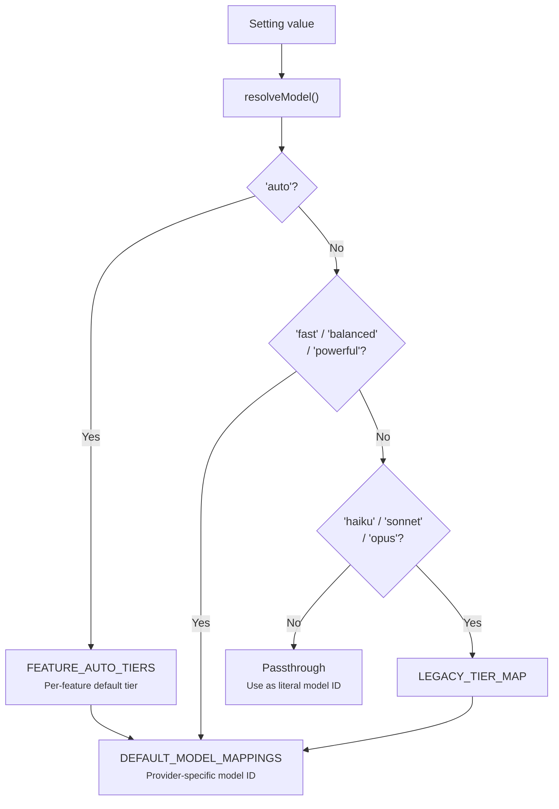

# Model Resolution

Sidekick uses a tier-based model resolution system that maps abstract tiers to provider-specific model IDs.

## Resolution Flow

## Tiers

| Tier       | Use Case                                               | Claude Model | Codex Model   |
| ---------- | ------------------------------------------------------ | ------------ | ------------- |
| `fast`     | Low latency, frequent calls (inline completions, docs) | Haiku 4.5    | `gpt-6-luna`  |
| `balanced` | Quality/speed tradeoff (explanations, commits, review) | Sonnet 5     | `gpt-6-sol`   |
| `powerful` | Highest quality (code transforms)                      | Opus 5.5     | `gpt-6-astra` |

The Claude column resolves per inference provider: `claude-max` passes the short
names (`haiku` / `sonnet` / `opus`) to the CLI, while `claude-api` and `opencode`
resolve to versioned IDs such as `claude-sonnet-5` and `claude-opus-5-5` (with an
`anthropic/` prefix for OpenCode). Native Claude aliases follow the installed
CLI's model mapping.

These defaults were reviewed on September 22, 2026 against the
[Anthropic model overview](https://platform.claude.com/docs/en/models/overview)
and [OpenAI model guidance](https://developers.openai.com/api/docs/guides/latest-model?model=gpt-5.6).

## Per-Feature Defaults

When a model setting is `"auto"`, it resolves to the recommended tier for that feature:

| Feature            | Default Tier |
| ------------------ | ------------ |
| Inline completions | fast         |
| Documentation      | fast         |
| Code transforms    | powerful     |
| Commit messages    | balanced     |
| Explanations       | balanced     |
| Error analysis     | balanced     |
| Inline chat        | balanced     |
| Code review        | balanced     |
| PR descriptions    | balanced     |

## Legacy Names

For backward compatibility, legacy Claude model names are mapped to tiers:

| Legacy Name | Maps To  |
| ----------- | -------- |
| `haiku`     | fast     |
| `sonnet`    | balanced |
| `opus`      | powerful |

## Literal Model IDs

You can bypass the tier system entirely by setting a full model ID (e.g., `claude-sonnet-5` or `gpt-5.6-sol`). This is passed directly to the provider without any mapping.

Use `claude-fable-5-1` explicitly for Anthropic's most capable model when your
provider account supports it, or `claude-opus-5` / `gpt-5.6-sol` to keep the
previous powerful defaults. The automatic powerful tier uses Opus 5.5 or Astra.
The GPT-6 Codex tiers need a Codex CLI that offers `gpt-6-luna` and
`gpt-6-sol`; on an older CLI, set a literal ID such as `gpt-5.6-luna` or
`gpt-5.6-terra`.

## CLI Dashboard Summaries

The CLI dashboard has separate inference defaults for its short session
summaries. Direct Anthropic API calls use `claude-haiku-4-5-20251001`; direct
OpenAI API calls use `gpt-6-luna` with reasoning disabled and a 1,024-token
completion limit. Summaries generated through `claude --print` or `codex exec`
inherit the native CLI's model configuration.

## Pricing and Context Metadata

The shared model catalog supplies cost estimates and context gauges to the CLI
and VS Code. Catalog hydration reuses cached LiteLLM data for up to 24 hours,
then attempts a refresh. Bundled metadata covers models missing from the catalog. Observed context windows
take precedence over published limits when they match the same model, so a
provider's effective account limit can be smaller than the published maximum.
Quota utilization comes from separate provider APIs or local samples.

The offline baseline was refreshed on October 30, 2026 for GPT-6.1 Sol and
Terra, Claude Sonnet 5.5 and Haiku 5.5, Gemini 4 Argon and 3.8 Flash,
DeepSeek Flash and V4 Pro, and GLM-5.3, Flash, and FlashX. It includes direct
provider-qualified IDs and the accepted legacy DeepSeek Flash names. Inference
tier defaults are independent of this metadata refresh.

Verification sources:

- [GPT-6.1 Sol](https://developers.openai.com/api/docs/models/gpt-6.1-sol) and
  [GPT-6.1 Terra](https://developers.openai.com/api/docs/models/gpt-6.1-terra):
  published context maxima of 1,050,000 tokens; account-specific Codex limits can be smaller.
- [Anthropic pricing](https://platform.claude.com/docs/en/about-claude/pricing)
  and [model overview](https://platform.claude.com/docs/en/models/overview):
  Sonnet 5.5 cache reads cost $0.10 per million tokens; Haiku 5.5 supports 1M context.
- [Gemini pricing](https://ai.google.dev/gemini-api/docs/pricing),
  [Argon limits](https://ai.google.dev/gemini-api/docs/models/gemini-4-argon), and
  [Flash limits](https://ai.google.dev/gemini-api/docs/models/gemini-3.8-flash).
- [DeepSeek models and pricing](https://api-docs.deepseek.com/quick_start/pricing/).
- [z.ai pricing](https://docs.z.ai/guides/overview/pricing),
  [GLM-5.3](https://docs.z.ai/guides/llm/glm-5.3), and
  [Flash/FlashX API limits](https://docs.z.ai/guides/vlm/glm-5.3-flash):
  the static API baseline uses the documented 1M context; local weights and
  hydrated catalogs may offer a different limit.

Prices remain estimates at global standard, short-context rates. Cache-write
rates use the shortest published retention period. Haiku 5.5 charges higher
rates for prompts over 100,000 tokens; the baseline uses its lower tier.
DeepSeek baselines use peak rates; off-peak rates are half as much. Gemini
Argon's introductory $2/$10 input/output rates ($0.10 cached input) end on
November 30, 2026, then double. Gemini 3.8 Flash's introductory $0.75/$3.75
rates ($0.075 cached input) end on December 31, 2026, then double. These offline
baselines do not change with the clock; catalog hydration can refresh rates.
Cache-storage charges, request tools, service tiers, regional adjustments, and
other billing modifiers are excluded. Provider-reported costs remain preferred
when available.

When reviewing a new coding model:

1. Verify its input, output, cache-write, and cache-read prices against official
   documentation, including promotions and prompt-length tiers.
2. Verify its published API context limit separately from output caps and
   account-specific effective limits.
3. Add explicit baseline keys for distinct rates and context limits, supported
   spellings, and direct-provider forms; avoid generic pricing fallbacks.
4. Test exact provenance, snapshot suffixes, offline and failed-download paths,
   predecessor rates, override precedence, and browser catalog export/import.
