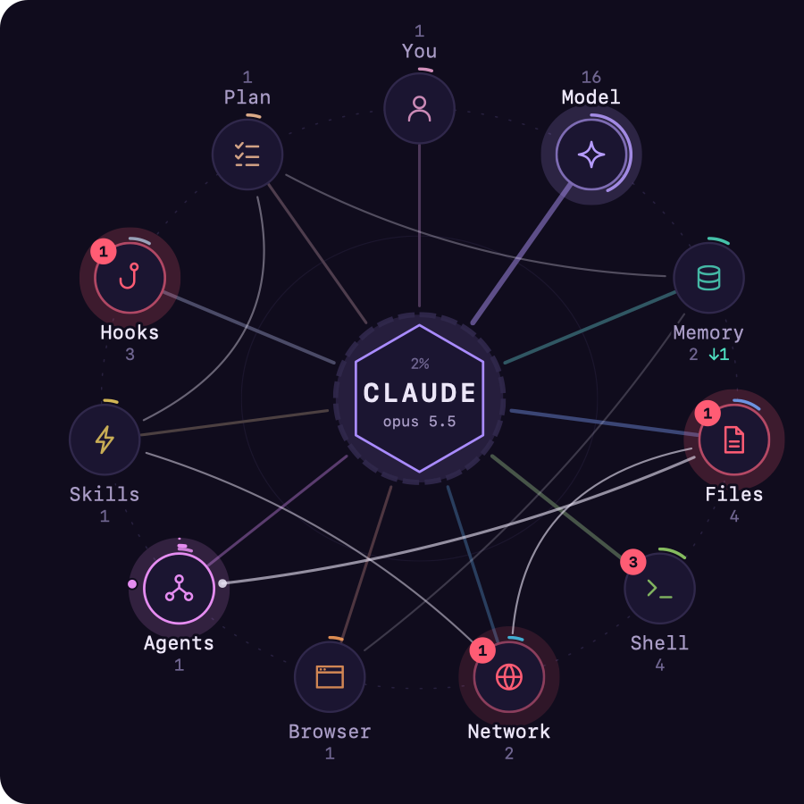

# Activity Map

A live and replayable map of what your coding agent is doing. The agent sits at the centre with its context window as a ring around it. Every tool call pulses out to one of eleven stations and back, so you see the files, shell, network, memory and subagents at work instead of reading a list of commands. Afterwards, the map shows where the session's time, faults and context went.

It works the same for Claude Code, Codex and OpenCode, from their session logs. That means you can also replay any past session and scrub through it.



## Stations

| Station     | Lights up for                                                                                                                                                                                             |
| ----------- | --------------------------------------------------------------------------------------------------------------------------------------------------------------------------------------------------------- |
| **You**     | your prompts, questions the agent asks you (`AskUserQuestion`), files and notifications sent to you                                                                                                       |
| **Model**   | each model step; a model change rings the core and this station                                                                                                                                           |
| **Memory**  | Claude Code's memory folder, instruction files (`CLAUDE.md`, `AGENTS.md`), memory MCP servers and commands you name. Memory a hook or the agent pushed into context without asking is counted apart (`↓`) |
| **Files**   | Read, Write, Edit, Grep, Glob, LSP, Codex patches, and shell commands that only read, search, move or edit files (`cat`, `rg`, `sed -i`, `mv`)                                                            |
| **Shell**   | every other shell command                                                                                                                                                                                 |
| **Network** | web fetch and search, MCP servers, and shell commands known to reach the network (`curl`, `gh`, `ssh`, `git push`, `npm install`, cloud CLIs), also inside `$(…)`                                         |
| **Browser** | browser MCP servers (Claude in Chrome, Playwright, Puppeteer, Chrome DevTools, …)                                                                                                                         |
| **Agents**  | subagents and workflows (Claude Code `Agent`/`Task`, Codex `spawn_agent`, OpenCode subtasks); their own calls start from this station                                                                     |
| **Skills**  | skills, slash commands and tool search                                                                                                                                                                    |
| **Hooks**   | settings hooks that block a call, ask for permission, add context, fail, or take a moment (Claude Code records them in its session log)                                                                   |
| **Plan**    | todo lists, task tools, plan mode and Codex plan updates                                                                                                                                                  |

Shell commands are classified by the command's name, not by what a script does internally: `python -c "…"` that opens a connection shows as Shell.

## Reading the map

- **Pulses.** A pulse flies out when a call starts and returns when it ends. Calls that run together fly side by side, and the station shows how many as `×3`.
- **Worn spokes.** A spoke grows thicker the more its station is used, so by the end of a session the map shows where the work went.
- **Clock hands.** While a call runs, two hands grow around its station: the inner one laps in a minute, the outer in ten. The Model station gets them while the model is thinking with no call open.
- **Faults.** Errors and denials leave a red count on the station until your next prompt.
- **The route.** A line joins the last stations the main loop visited, in order; the newest leg draws itself.
- **Context.** The ring around the core fills as the session goes. It turns amber at 70% and red at 90%, and empties at a compaction.
- **Subagents** still at work orbit the Agents station.
- **Patterns** are drawn on the map: a **retry streak** (a station failed three or more times in a row) glows on that station, and an **alternation** (three or more back-and-forth cycles between two stations, such as an edit ↔ test loop) is drawn as a double arc with its count.
- **The answer.** One wide ring leaves the core when a turn finishes.

Below the map, a feed lists the latest activity. Finished calls in a row at one station fold into one row, marked `+2` for the two it stands for besides the one named.

## Insights

For a whole session, the map also reports:

- **Time per station**: wall-clock time with a call open, and its share of the session's busy time.
- **Errors, denials and cancellations** per station.
- **Context weight**: how much tool output each station fed into the context window (characters, and an estimate in tokens). This is where a session's context went.
- **Patterns**: retry streaks (open, recovered or abandoned) and alternations.
- **Models**, the slowest calls, hook runs and time, memory pushes and compactions.

## In VS Code

Open **Activity Map** in the Agent Hub sidebar, next to the Mind Map. It follows the current session live, including the history read before VS Code started.

- **Pop out** opens the map large in an editor tab, with insights beside it and a replay bar: play and pause, 1×/10×/60× speed, a scrubber with markers for prompts, faults, compactions and model switches, and **Live** to return to the present. Keys: <kbd>Space</kbd> play/pause, <kbd>←</kbd>/<kbd>→</kbd> ±5 s (<kbd>Shift</kbd> ±60 s), <kbd>Home</kbd>/<kbd>End</kbd>, <kbd>L</kbd> live, <kbd>1</kbd>/<kbd>2</kbd>/<kbd>3</kbd> speed.
- **Hover** a station for its calls, time, errors and top labels; **click** it to filter the feed and highlight it on the map.
- **Export Activity Map…** saves the map as SVG or the session's activity as JSON.
- The HTML session report includes the map and the station table.

Settings (`sidekick.activityMap.*`):

| Setting            | Default       | Meaning                                                                                                   |
| ------------------ | ------------- | --------------------------------------------------------------------------------------------------------- |
| `motion`           | `auto`        | `auto` follows VS Code's reduce-motion setting and the OS; `full`, `reduced` (fades only) or `none`       |
| `layout`           | `you-top`     | `you-top`, or `you-bottom` (the network and browser at the top)                                           |
| `coreName`         | (provider)    | what the core says, up to ten characters                                                                  |
| `labels`           | `descriptive` | `descriptive` shows the short description the agent wrote for a command; `names` shows names only; `none` |
| `memory`           | —             | extra memory `paths`, `mcpServers` and `commands`                                                         |
| `stationOverrides` | —             | map a tool name or `mcp__server__*` to a station                                                          |

Classification settings apply to new activity; reopen the session to reclassify what was already read.

## In the terminal

`sidekick map --follow` draws the live map in any terminal, for any provider. Run it in a split beside your agent:

```bash
# tmux: a pane to the right
tmux split-window -h 'sidekick map --follow'

# VS Code: Terminal → Split Terminal, then
sidekick map --follow
```

It waits for a session if none has started yet and follows newer sessions as they begin (pass `--session <id>` to stay on one). Keys: <kbd>f</kbd> feed, <kbd>i</kbd> insights, <kbd>p</kbd> or <kbd>Space</kbd> pause, <kbd>←</kbd>/<kbd>→</kbd> step while paused, <kbd>l</kbd> live, <kbd>q</kbd> quit.

Export a session instead:

```bash
sidekick map --format text                 # the map, feed and insights in the terminal
sidekick map --format svg -o session.svg   # a still SVG (add --motion full to animate)
sidekick map --format json --at 50%        # snapshot and insights halfway through, as JSON
```

`--at` picks the moment:

| Value               | Meaning                                |
| ------------------- | -------------------------------------- |
| `end` (default)     | the end of the session                 |
| `start`             | the start                              |
| `+15m`, `+1h30m`    | that long after the session started    |
| `-5m`               | that long before it ended              |
| `50%`               | that far through the session           |
| `14:03`, `14:03:20` | that time of day on the session's date |
| an ISO 8601 time    | that moment                            |

The [dashboard](cli.md) has the same map as panel **9**, with an Insights tab.

## For agents (MCP)

Sidekick's [MCP facts server](mcp.md) offers `get_activity_map`: the active session's snapshot and insights as structured data plus a short text summary, optionally with the SVG. An agent can use it to see where its own session's time went, or to notice that it is stuck in a retry loop.

## Privacy

Activity records hold names, never content:

- a file: the last two parts of its path;
- a web address: the host alone, never a login, password, path or query;
- a shell command: the command's name (and a known subcommand such as `git push`), never the command line. The `descriptive` label setting adds the short description the agent itself wrote;
- an MCP call: the server and tool name;
- a hook: its event and matcher, never its command, output or the context it added;
- a subagent: its type.

Control and bidirectional-text characters are removed from every label. The JSON export and the MCP tool use names-only labels.

## Accessibility

The map has a text description that updates as the session goes, and every station, pattern and replay control can be reached from the keyboard through the insights table and the replay bar. Motion follows your reduce-motion settings.
