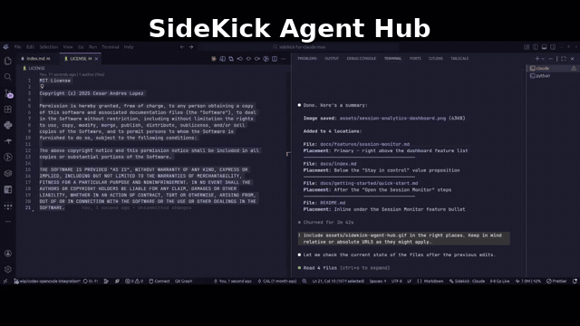

# Inline Completions

Context-aware completions that understand your project. Unlike generic autocomplete, these suggestions factor in surrounding code, imports, and patterns — so you spend less time typing boilerplate and more time thinking about architecture.

Completions appear as ghost text that you can accept with Tab.

## Usage

- **Trigger**: `Ctrl+K Ctrl+Shift+Space` (`Cmd+K Cmd+Shift+Space` on Mac), or run "Sidekick: Trigger Completion". Completions are on demand; they don't appear while you type.
- **Accept**: Press `Tab`
- **Dismiss**: Press `Escape`
- **Toggle**: Run "Sidekick: Toggle Inline Completions". Clicking "Sidekick" in the status bar opens the Sidekick menu, and the status bar item shows a slashed-circle icon while completions are off.

## Configuration

| Setting                          | Default | Description                                                                                                                  |
| -------------------------------- | ------- | ---------------------------------------------------------------------------------------------------------------------------- |
| `sidekick.enabled`               | `true`  | Enable/disable inline completions                                                                                            |
| `sidekick.inlineModel`           | `auto`  | Model tier — resolves to `fast` for low latency; requests ask for minimal reasoning (thinking off where the model allows it) |
| `sidekick.debounceMs`            | `0`     | Delay before a triggered request is sent (ms); a newer trigger within it replaces the pending one                            |
| `sidekick.inlineContextLines`    | `30`    | Lines of context before/after cursor                                                                                         |
| `sidekick.multiline`             | `false` | Enable multi-line completions (up to 10 lines)                                                                               |
| `sidekick.showCompletionHint`    | `true`  | Show visual hint at cursor                                                                                                   |
| `sidekick.completionHintDelayMs` | `1500`  | Delay before showing hint (ms)                                                                                               |

!!! note

    Prose files (Markdown, plaintext, HTML, XML, LaTeX) automatically use multiline mode regardless of the `multiline` setting.

## Multiple Windows

Each VS Code window runs its own extension instance with independent caches. Completions cached in one window are not available in another. All windows share the same authentication.
