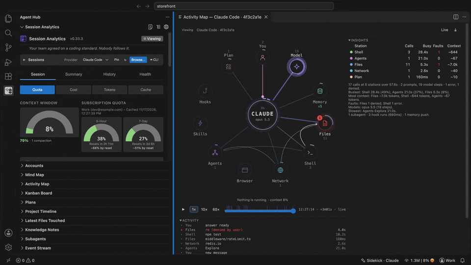
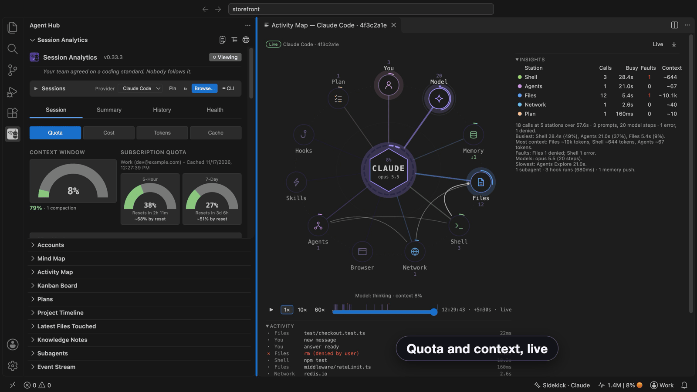

# Quick Start

In a few minutes you'll see what your agent is doing and what it costs, in VS Code or the terminal. The AI features (on-demand completions, code transforms, commit messages) are there when you want them.



After [installing](installation.md) the extension, start a Claude Code, Codex, or OpenCode session in your project. Monitoring reads the session files the agent writes, so it needs no further setup. The AI features need an [inference provider](provider-setup.md).

## Open the Session Monitor

1. Click the **Agent Hub** icon in the activity bar (left sidebar)
2. The Session Analytics dashboard shows tokens, cost, context fill, and quota for the session in progress
3. Below it, the Accounts view, Mind Map, Activity Map, Kanban Board, and six more views start collapsed — click a section header to expand the one you need



## Watch the Activity Map

Expand **Activity Map** to see each tool call pulse out to the files, shell, network, memory, or subagent station it touched. The **Open Activity Map** button in the view's title bar opens the map large in an editor tab with a replay bar. See [Activity Map](../features/activity-map.md).

## CLI Dashboard

If you installed the [CLI](installation.md#cli-terminal-dashboard), you can monitor agent sessions from any terminal:

```bash
sidekick dashboard
```

The dashboard auto-detects your project and provider (Claude Code, OpenCode, or Codex). Use number keys **1–9** to switch panels, **Tab** to move focus between the list and the detail pane, and **[** / **]** to switch detail tabs. You'll see live session activity, token usage, tasks, a mind map, and more.

For the activity map on its own, run `sidekick map --follow` in a second terminal or tmux pane.

See [CLI reference](../features/cli.md) for the full command list.

## Your First Completion

1. Open any code file and put the cursor where you want code
2. Press `Ctrl+K Ctrl+Shift+Space` (`Cmd+K Cmd+Shift+Space` on Mac) — the completion appears as ghost text
3. Press **Tab** to accept, **Escape** to dismiss

## Try a Code Transform

1. Select some code
2. Press `Ctrl+K Ctrl+Shift+M` (`Cmd+K Cmd+Shift+M` on Mac)
3. Type an instruction like "Add error handling" or "Convert to async/await"
4. The selection is replaced with the transformed code

## Generate a Commit Message

1. Stage your changes in the Source Control panel
2. Click the sparkle icon in the Source Control toolbar
3. A commit message is generated from your diff

## Key Shortcuts

| Action             | Windows / Linux           | macOS                   |
| ------------------ | ------------------------- | ----------------------- |
| Trigger Completion | `Ctrl+K Ctrl+Shift+Space` | `Cmd+K Cmd+Shift+Space` |
| Transform Code     | `Ctrl+K Ctrl+Shift+M`     | `Cmd+K Cmd+Shift+M`     |
| Generate Docs      | `Ctrl+K Ctrl+G`           | `Cmd+K Cmd+G`           |
| Explain Code       | `Ctrl+K Ctrl+E`           | `Cmd+K Cmd+E`           |
| Quick Ask          | `Ctrl+K Ctrl+A`           | `Cmd+K Cmd+A`           |
| Switch Account     | `Ctrl+K Ctrl+Shift+A`     | `Cmd+K Cmd+Shift+A`     |

!!! tip

    Click "Sidekick" in the status bar for quick access to settings, logs, and provider switching.

## Command Hub & Troubleshooting

- **Sidekick: Show Menu** — a QuickPick command hub listing every Sidekick command in one place
- **Sidekick: Run Doctor** — diagnoses project, session, account, provider, and dependency health when something isn't working
- **Sidekick: Install Statusline** — merges a Sidekick status-line command into your Claude Code settings (uninstalling restores the previous block)

The [VS Code Command Reference](../features/vscode-commands.md) lists every command with its default keybinding.
