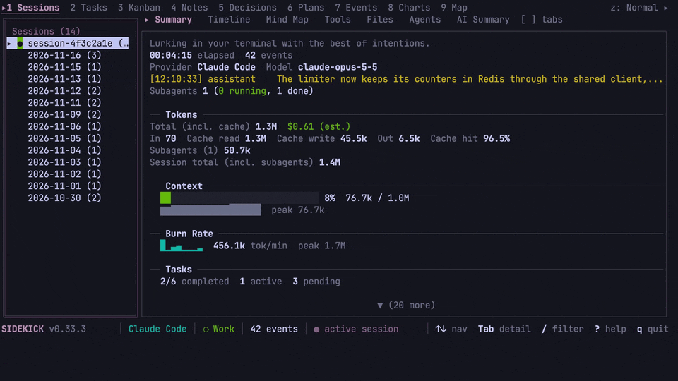
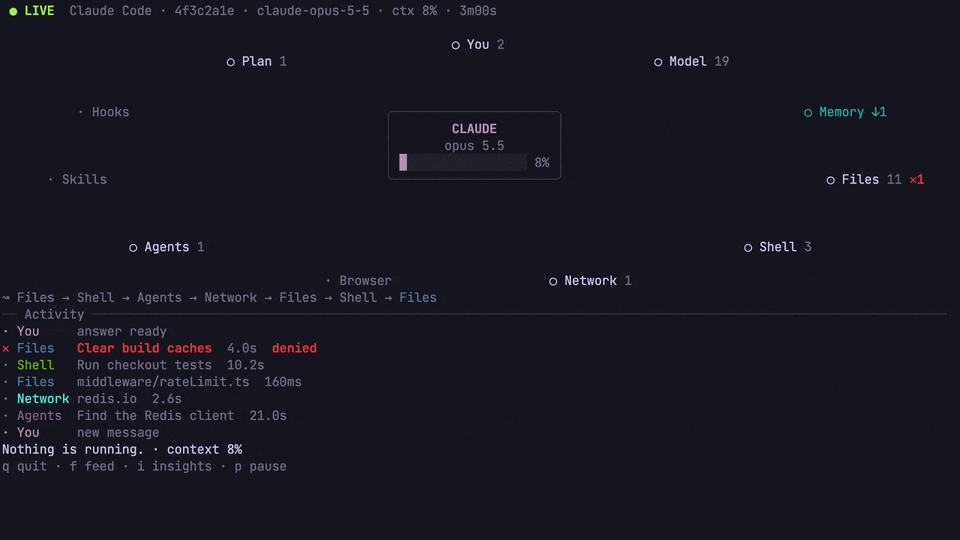
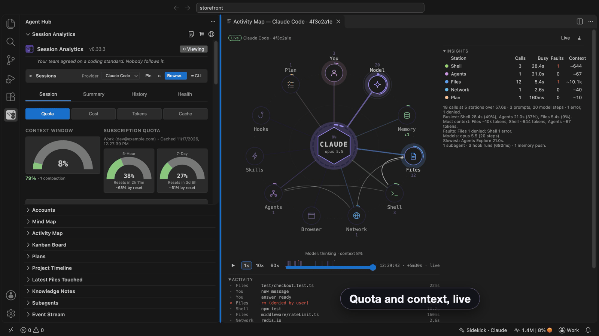
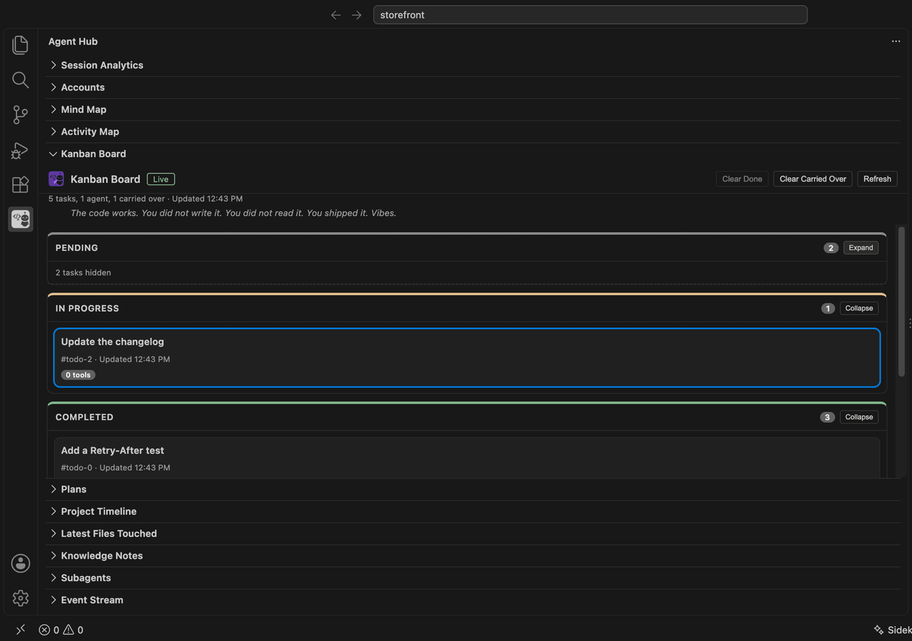
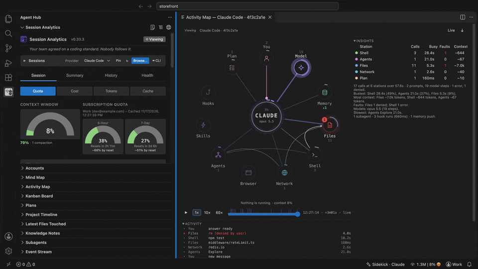

# Sidekick Agent Hub

**See what your AI coding agents are doing, and what they cost.** Live monitoring for Claude Code, Codex and OpenCode, in VS Code and the terminal.



[](https://open-vsx.org/extension/cesarandreslopez/sidekick-for-max)
[](https://open-vsx.org/extension/cesarandreslopez/sidekick-for-max)
[](https://marketplace.visualstudio.com/items?itemName=CesarAndresLopez.sidekick-for-max)
[](https://marketplace.visualstudio.com/items?itemName=CesarAndresLopez.sidekick-for-max)
[](https://www.npmjs.com/package/sidekick-agent-hub)
[](https://www.npmjs.com/package/sidekick-agent-hub)
[](https://github.com/cesarandreslopez/sidekick-agent-hub/blob/main/LICENSE)

Sidekick reads the session files your agent already writes. There is no proxy and no wrapper: you keep running `claude`, `codex` or `opencode` the way you do now, and Sidekick follows along in the editor sidebar or a second terminal.

## What Sidekick Does For You

### What it's doing

The [Activity Map](features/activity-map.md) draws every tool call as it happens: the files the agent reads and edits, the shell commands it runs, the network calls it makes, the subagents it spawns. Afterwards it shows where the session's time, errors and context went, and any past session can be replayed. The session timeline, mind map and event stream show the same session as a list, a graph and a live feed.



### What it costs

Tokens (cache included), estimated cost per model, how full the context window is, and how much of your plan's quota is left: the five-hour and weekly limits for Claude, the rate-limit windows for Codex. The current five-hour billing block shows its burn rate and where it will end up. Daily, weekly and monthly usage reports are computed from the session logs, so they also cover sessions from before you installed Sidekick, as long as the logs are still on disk.



### What to keep

When a session ends, what it learned usually goes with it. Sidekick keeps tasks, decisions, knowledge notes and plans per project, and can write a handoff document so the next session starts where this one stopped instead of from zero. The extension and the CLI share the same stores.



### Also

- **Account switching.** Keep several Claude Code and Codex logins and switch between them without `/logout`, from the VS Code Accounts view or `sidekick accounts`. Every switch is verified and can be undone.
- **A facts server for your agent.** `sidekick mcp` is a read-only MCP server the agent can query for its own quota, burn rate, context pressure, activity map, tasks, decisions and notes.
- **AI features, when you want them.** In VS Code, Sidekick can also write commit messages, transform selected code, explain code and errors, review your changes, and complete code on demand. These run through your Claude subscription, the Claude API, OpenCode or Codex CLI.

## Install

### VS Code extension

Install **Sidekick Agent Hub** from the [VS Code Marketplace](https://marketplace.visualstudio.com/items?itemName=CesarAndresLopez.sidekick-for-max) or [Open VSX](https://open-vsx.org/extension/cesarandreslopez/sidekick-for-max) (Cursor, VSCodium and other forks). Click the **Agent Hub** icon in the activity bar: Sidekick detects which agent you use and attaches to its most recent session. See [Installation](getting-started/installation.md) and the [Quick Start](getting-started/quick-start.md).

### Terminal

> **Note:** The npm package is `sidekick-agent-hub`, but the binary is called **`sidekick`**.

```bash
npm install -g sidekick-agent-hub
sidekick dashboard
```

Requires Node.js 20+, or 22.15+ to read the compressed sessions (`.jsonl.zst`) Codex writes for older rollouts. The CLI works standalone, with any editor or none. Run it in a second terminal or a tmux pane beside your agent, or run `sidekick map --follow` there for the live activity map. See [CLI Dashboard](features/cli.md) for the full guide.

### Shared library

Building your own tool on top of Sidekick session data? The [`sidekick-shared`](https://www.npmjs.com/package/sidekick-shared) npm package provides types, parsers, session providers, event aggregation, model pricing, Zod schemas, actionable session-asset extraction, and more — no VS Code or CLI dependency required.

```bash
npm install sidekick-shared
```

See the [Architecture Overview](architecture/overview.md) for what's included.

## Feature Highlights



### VS Code and CLI

Available in the VS Code extension and the [CLI dashboard](features/cli.md). The CLI works standalone — no VS Code extension required.

- **Session Monitor** — tokens (cache included), cost per model, context fill, burn rate, compactions, and the session timeline, live. See [Session Monitor](features/session-monitor.md)
- **Activity Map** — every tool call pulses out to one of eleven stations (files, shell, network, memory, agents, …) and back, live or replayed: a sidebar view and editor tab in VS Code, and `sidekick map` in the terminal (`--follow` for a live full-screen map, or text, SVG and JSON exports at any moment with `--at`). See [Activity Map](features/activity-map.md)
- **Quota** — Claude's five-hour and weekly limits, plus extra meters such as a weekly Fable cap; Codex rate-limit windows; z.ai Coding Plan quota for OpenCode. Threshold alerts fire once per reset window, and `sidekick quota` / `sidekick quota history` check it from the shell
- **Usage Reports & Billing Blocks** — `sidekick daily`, `weekly`, `monthly` and `sessions` compute usage straight from session logs; five-hour billing blocks (`sidekick blocks`, and a card in both dashboards) show the burn rate and end-of-block projections
- **Account Switcher** — keep several Claude Code and Codex logins and switch between them with a verified, undoable switch: the Accounts view and `Ctrl+K Ctrl+Shift+A` in VS Code, `sidekick accounts` and the `A` overlay in the terminal dashboard. Run two accounts side by side and see credential health before it fails; VS Code can also switch automatically at a quota threshold. See [Account Switcher](features/account-switcher.md) and the [Account Management](providers/account-management.md) API
- **Mind Map** — trace how your agent navigated the codebase, with cycling file and goal-gate indicators
- **Kanban Board** — track tasks and subagents at a glance, with goal-gate badges on critical tasks
- **Plans** — the plan your agent is working through, step by step, and the plans of earlier sessions. See [Plans](features/plans.md)
- **Knowledge Notes** — capture gotchas, patterns, guidelines, and tips attached to files, with lifecycle tracking
- **Decision Log & Session Handoff** — decisions extracted from sessions, and handoff documents so the next session picks up where you left off
- **Provider Status** — live API health scoped to the monitored provider: Claude for Claude Code sessions, OpenAI for Codex sessions, hidden for OpenCode; `sidekick status` checks both
- **HTML Session Report** — self-contained HTML report with full transcript, token/cost stats, the activity map, and tool-use breakdown
- **Session Asset Extraction** — pull URLs, file paths, commands, and plans out of recent Claude Code and Codex chats (`Sidekick: Extract Session Assets` or `sidekick extract`)

### VS Code only

- **Session Analytics tabs** — Summary (metrics plus an optional AI narrative), History (usage over time, by model, tool or project), and Health (the doctor checks in place)
- **Project Timeline** — chronological view of the project's sessions with duration, token usage, and expandable details. See [Project Timeline](features/project-timeline.md)
- **Context Health** — track how much information your agent has lost to context compaction
- **Truncation Detection** — know when tool outputs are silently cut short
- **Cycle Detection** — get alerted when your agent enters repetitive loops
- **Peak Hours Indicator** — subtle orange pill + status-bar glyph when Claude is in a peak window (faster session-limit drain); only appears on Claude Max subscriptions (`sidekick peak` checks from the terminal). See [Peak Hours](features/peak-hours.md)
- **Accessibility** — `prefers-reduced-motion` support, keyboard navigation, ARIA landmarks, and focus-visible indicators across all panels

The full list of commands and default keybindings is in the [VS Code Command Reference](features/vscode-commands.md).

### CLI only

- **MCP Facts Server** — `sidekick mcp` serves read-only quota, burn-rate, context, activity-map, task, decision, and note facts over MCP stdio, for Claude Code or Codex to query. See [MCP Facts Server](features/mcp.md)
- **Status Line** — `sidekick statusline` puts the account, quota windows, context, session cost, and cache hit rate in Claude Code's status line, and records Claude's official rate limits for every other surface. `Sidekick: Install Statusline` sets it up from VS Code. A public, versioned `state.json` feeds tmux bars and scripts. See [Daily brief and diagnostics](features/cli.md#daily-brief-and-diagnostics)
- **One-shot commands** — `sidekick today`, `doctor`, `search`, `history`, `dump`, `report`, and quick capture with `tasks add`, `note add`, and `decision add`. See the [Command Reference](features/cli.md#command-reference)

### AI features (VS Code)

- **Inline Completions** — on demand with `Ctrl+K Ctrl+Shift+Space`, using your project context
- **Code Transforms** — select code, describe changes in natural language
- **AI Commit Messages** — messages generated from your actual diff
- **Quick Ask** — inline chat for questions and code changes without switching context
- **Code Review** — catch bugs and security concerns before they reach your team
- **PR Descriptions** — structured summaries from branch diff, ready to paste
- **Error Analysis** — understand what went wrong, why, and how to fix it, with color-coded explanation sections and one-click Apply Fix
- **CLAUDE.md Suggestions** — learn from session patterns to improve agent effectiveness

## Supported Agents and Providers

| Agent           | Monitoring         | Account switching  | Quota                                                       |
| --------------- | ------------------ | ------------------ | ----------------------------------------------------------- |
| **Claude Code** | :white_check_mark: | :white_check_mark: | Five-hour and weekly limits (Ultra has no five-hour window) |
| **Codex CLI**   | :white_check_mark: | :white_check_mark: | Primary and secondary rate-limit windows                    |
| **OpenCode**    | :white_check_mark: | :x:                | z.ai Coding Plan quota when OpenCode is routed through z.ai |

The AI features use a separate inference provider, chosen independently of the agent you monitor:

| Inference provider | Cost                           |
| ------------------ | ------------------------------ |
| **Claude Max**     | Included in subscription       |
| **Claude API**     | Per-token billing              |
| **OpenCode**       | Depends on configured provider |
| **Codex CLI**      | ChatGPT plan or API billing    |

See [Provider Setup](getting-started/provider-setup.md).

## Why Am I Building This?

AI coding agents are the most transformative tools I've used in my career. They can scaffold entire features, debug problems across files, and handle the mechanical parts of software engineering that used to eat hours of every day.

But they're also opaque. Tokens burn in the background with no visibility. Context fills up silently until your agent starts forgetting things. And when a session ends, everything it learned — your architecture, your conventions, the decisions you made together — is just gone. The next session starts from zero.

That bothers me. I want to see what my agent is doing. I want to review every tool call, understand where my tokens went, and carry context forward instead of losing it. Sidekick exists because I think the people using these agents deserve visibility into how they work — not just the output, but the process.

## See Also

**[Sidekick Docker](https://github.com/cesarandreslopez/sidekick-docker)** — a sibling project that brings the same real-time dashboard experience to Docker management. Monitor containers, Compose projects, images, volumes, and networks from a keyboard-driven TUI or VS Code panel. Available as a [VS Code extension](https://marketplace.visualstudio.com/items?itemName=CesarAndresLopez.sidekick-docker-vscode), [Open VSX extension](https://open-vsx.org/extension/CesarAndresLopez/sidekick-docker-vscode), and [CLI](https://www.npmjs.com/package/sidekick-docker).

## Contributing

Contributions welcome! See the [Contributing Guide](contributing.md).

## Community

If Sidekick is useful to you, a [star on GitHub](https://github.com/cesarandreslopez/sidekick-agent-hub) helps others find it.

Found a bug or have a feature idea? [Open an issue](https://github.com/cesarandreslopez/sidekick-agent-hub/issues) — all feedback is welcome.

## License

MIT
