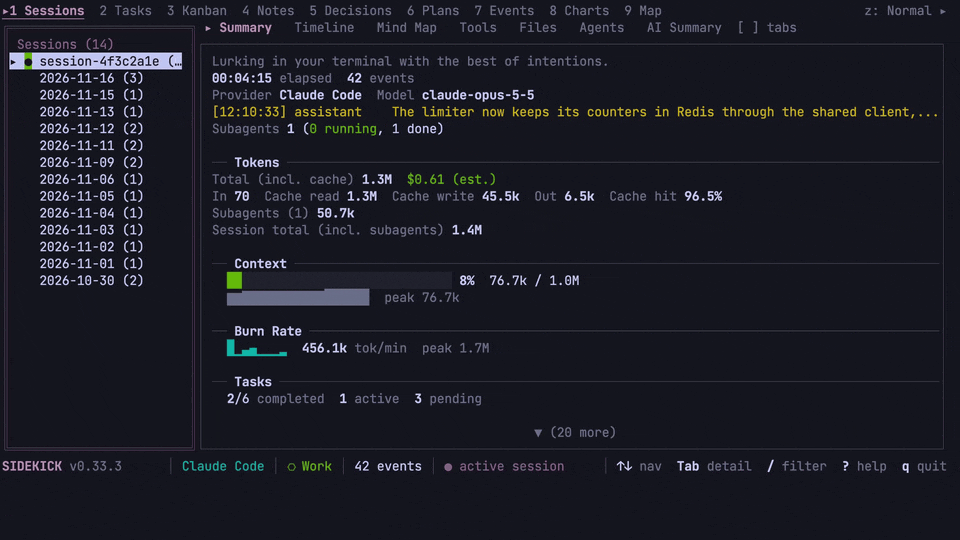
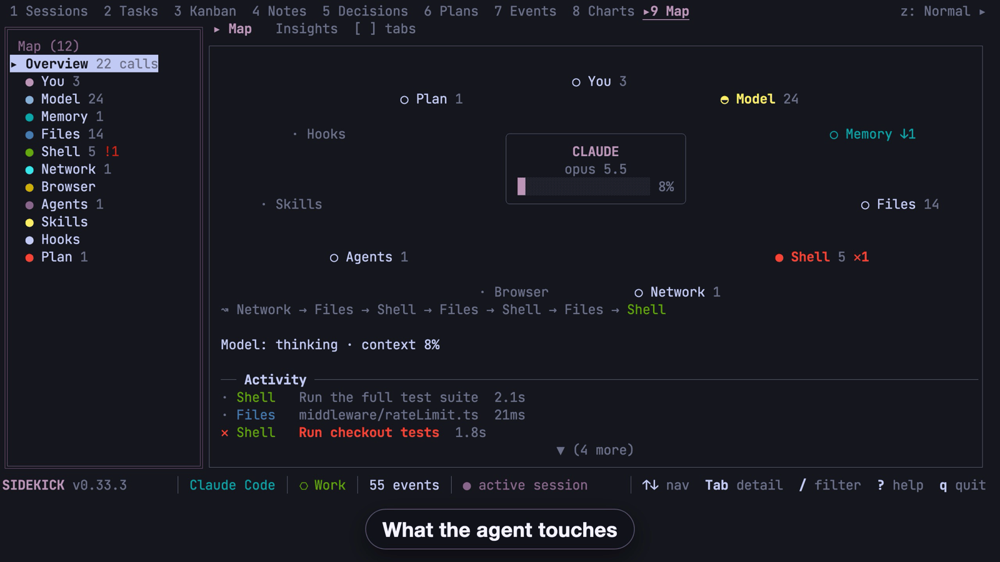
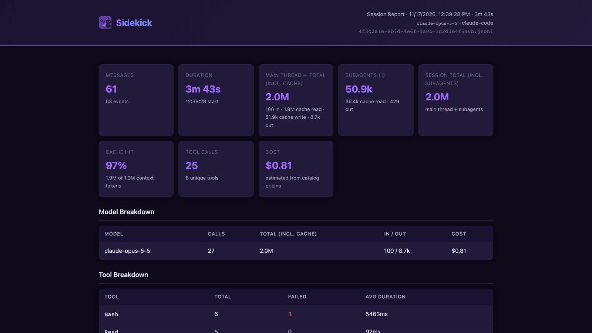
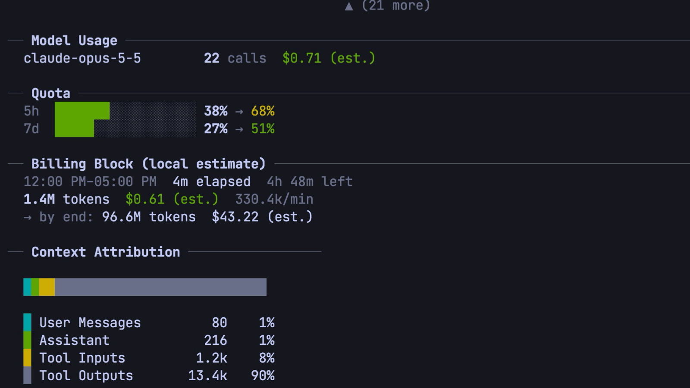
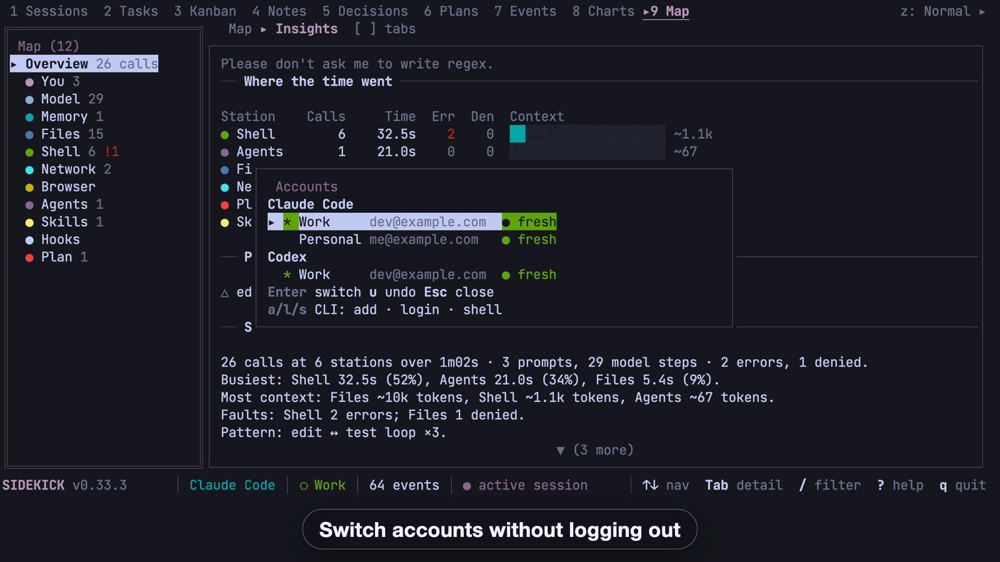

# Sidekick CLI

**See what your AI coding agents are doing, and what they cost**, in your terminal. Live monitoring for Claude Code, Codex and OpenCode sessions, with no VS Code required.



Coding agents work out of sight. Tokens burn in the background, the context window fills up without warning, and when a session ends, what it learned is gone. `sidekick` reads the session files your agent already writes and shows you:

- **What it's doing**: every tool call, file and subagent, live, on an activity map (`sidekick dashboard`, `sidekick map --follow`).
- **What it costs**: tokens, cost, context fill, plan quota and five-hour billing blocks (`sidekick quota`, `sidekick daily`, `sidekick blocks`).
- **What to keep**: tasks, decisions and knowledge notes that carry across sessions (`sidekick tasks`, `sidekick decisions`, `sidekick notes`), and the handoff the VS Code extension writes when a session ends (`sidekick handoff`).

Monitoring needs no proxy and no wrapper: keep running `claude`, `codex` or `opencode` as you do today. The CLI reads and writes the same store as the [VS Code extension](https://marketplace.visualstudio.com/items?itemName=CesarAndresLopez.sidekick-for-max) (`~/.config/sidekick/`, `%APPDATA%\sidekick\` on Windows), and `sidekick mcp` lets the running agent query the same facts.

## Installation

> **Note:** The npm package is `sidekick-agent-hub`, but the binary it installs is called `sidekick`.

```bash
npm install -g sidekick-agent-hub
```

Requires **Node.js 20+**. Reading compressed Codex sessions (`.jsonl.zst`, which Codex writes for older sessions) needs Node 22.15 or later (built-in zstd); older Node versions skip them.

When a newer version is published, one-shot commands end with an `Update available: sidekick 0.30.0 → 0.30.1 — run npm install -g sidekick-agent-hub` line and a release-notes link on stderr, at most twice a day per version. It is never shown with `--json`, when output is piped, in CI, or from `statusline` and `mcp`; the dashboard shows the newer version in its status bar. Set `SIDEKICK_NO_UPDATE_NOTIFIER=1` (or `NO_UPDATE_NOTIFIER=1`) to turn it off. See [Update notifications](https://cesarandreslopez.github.io/sidekick-agent-hub/features/cli/#update-notifications).

## Quick Start

1. `cd` into your project directory
2. Run `sidekick dashboard`
3. The dashboard auto-detects your project and session provider
4. Press `?` to see all keybindings

> **OpenCode note:** OpenCode session monitoring reads `opencode.db` and currently expects an executable `sqlite3` runtime in the host environment.

OpenCode session data lives in OpenCode's platform-specific data directory:

- Linux: `~/.local/share/opencode/`
- macOS: `~/Library/Application Support/opencode/`
- Windows: `%LOCALAPPDATA%\opencode\` (falls back to `%APPDATA%`)

If `sqlite3` is missing or not executable in the current shell environment, Sidekick prints an actionable OpenCode-specific notice instead of silently failing session detection.

## Replay and Recovery

Selecting a session in the picker loads its history. When starting with `--session <id>`, add `--replay` to include earlier events; without it, the dashboard follows new activity only. Claude Code and Codex resume from a compatible complete-history checkpoint only while the session file is still the same file with the same opening content; a replaced or rewritten file is replayed from the start, and checkpoints saved before 0.32.0 replay once. A file truncated, rewritten or replaced while the dashboard follows it is also replayed from the start (a truncated Codex file is not counted twice), and once that replay completes the dashboard saves a fresh checkpoint. Otherwise live-only runs never replace those checkpoints, and OpenCode replays from the start when history is requested.

## Usage

```bash
sidekick dashboard [options]
sidekick tasks|decisions|notes|stats|import|blocks|daily|weekly|monthly|sessions|quota|status|accounts|handoff|search|context|extract [options]
sidekick dump|history|report|map|peak|today|doctor|statusline|mcp [options]
sidekick tasks add|tasks done|note add|decision add [args]
```

Most commands run one-shot queries and print to stdout; `dashboard` and `map --follow` open full-screen TUIs, `accounts` and `extract -i` open interactive pickers, and `mcp` serves stdio until closed. Every command lists the global flags below in its `--help`; `statusline` ignores `--json`, `--project` and `--provider`.

| Flag                   | Description                                                                                                  |
| ---------------------- | ------------------------------------------------------------------------------------------------------------ |
| `--json`               | Machine-readable JSON output (commands that support it)                                                      |
| `--project <path>`     | Override project path (default: current working directory)                                                   |
| `--provider <id>`      | Session provider: `claude-code`, `opencode`, `codex`, or `auto` (default)                                    |
| `--no-color`           | Disable colored output (also honors `NO_COLOR`)                                                              |
| `--offline`            | Price from the cached catalog only (also `SIDEKICK_OFFLINE=1`)                                               |
| `--output-file <path>` | Write a command's stdout to a file, without colour codes (ignored by `dashboard`, `mcp`, and `map --follow`) |

Per-command: `--session <id>` targets a specific session by ID (`dashboard`, `dump`, `report`, `map`, `handoff open`); `dashboard` and `map --follow` start pinned to it. `--replay` replays existing events from the beginning before streaming live (`dashboard` only).

## Daily Brief & Statusline

```bash
sidekick today
sidekick statusline
```

`sidekick today` prints a cache-only daily brief: yesterday's sessions/tokens/cost, open tasks, the newest decision, the latest handoff, a quota summary, and the scheduled peak-hours window. `sidekick statusline` renders the same account/quota/burn summary as a single line with no account bootstrap, pricing hydration, or quota network access, so it is fast enough to run on every agent prompt (add `"statusLine": { "type": "command", "command": "sidekick statusline" }` to `~/.claude/settings.json`, or run **Sidekick: Install Statusline** in VS Code; `sidekick statusline --help` prints the snippet). When Claude Code runs it as the status line it pipes a JSON document on stdin: Sidekick appends context usage, session cost, and prompt-cache hit rate, and persists the official limits (seven-day, plus five-hour on plans that have one) so every other command sees authoritative quota without a network call. Cached quota older than five minutes shows its age. Global flags `--project`, `--provider`, and `--json` apply to `today`; `statusline` has no options of its own (`SIDEKICK_STATUSLINE_STDIN=0` ignores stdin).

## Doctor

```bash
sidekick doctor
```

Diagnose project identity, sessions, accounts, providers, dependencies, and the pricing catalog in one typed health report — the same diagnostics behind the VS Code `Sidekick: Run Doctor` command. It warns when only the built-in price table or a stale catalog cache is active, or when `cli-config.json` pricing has invalid entries; `--json` adds `pricingCatalog`. Global flags `--project`, `--provider`, and `--json` also apply. `doctor` exits 1 when the report is unhealthy (an "attention" report still exits 0), so scripts can gate on it.

## Billing Blocks

```bash
sidekick blocks [--active | --recent | --since <time>] [--csv] [--no-cache]
```

Five-hour billing blocks computed from session logs (ccusage-style: a block opens at the first usage event, aligned to the UTC hour, lasts five hours, and a longer gap opens a new one). Each block shows its cache-inclusive token total, cost (`—` when nothing was priced, `$x (est.)` for catalog estimates, `$x (partial)` when some calls had no price), burn rate, and — for the open block — projected end-of-block tokens and cost (`—` for an unpriced block) plus the time remaining. Sessions are read once and cached by size and mtime under `~/.config/sidekick/usage-cache/` (format v4 since 0.32.1, files `*.v4.json`; the first run after upgrading re-reads each session once). When the status line has persisted an official Claude Code rate-limit sample, it is shown beneath the local estimate for comparison (on Ultra, which has no 5-hour limit, it shows `7d N% used · resets in … · no 5-hour limit`). `--since` accepts an ISO date, `YYYY-MM-DD`, or a relative window such as `7d`. The footer names the pricing catalog, for example `Pricing: LiteLLM catalog, fetched 9h ago · fnv1a64:…`; `--json` prints the full report (including `pricingCatalog`) and `--csv` one row per block.

## Import History

```bash
sidekick import [--since <time>]
```

Fold finished sessions from every provider into the history store that `sidekick stats`, `sidekick today`, and the VS Code History tab read — the same importer and store mutation the extension runs on first activation, so both hosts credit sessions identically. Idempotent: already-imported files, sessions the live monitor persisted, and files modified in the last minute are skipped. `--since` limits the scan; `--json` prints the result. Sessions stored before 0.27.3 keep their older, inflated token totals in `stats` and `today`; the log-based reports (`daily`, `blocks`, …) are recomputed.

## Usage Reports

```bash
sidekick daily|weekly|monthly|sessions [--since <time>] [--until <time>] [--breakdown] [--by-project] [--utc] [--csv] [--no-cache]
```

Usage computed straight from session logs — no VS Code extension or history store required — for every provider with session data side by side (`--provider` narrows to one). Rows are bucketed by the time of each usage event on the local calendar (`--utc` for UTC), so a session that crosses midnight is split across both days; Claude Code subagent transcripts count toward their parent session; weeks start on Monday. Report options and output:

- **Flags:** `--breakdown` adds per-model sub-rows (under each session too, for `sessions`), `--by-project` groups by project, and `--json` / `--csv` feed scripts.
- **Sessions:** `sessions` prints one row per session and tags Codex subagent and fork sessions `↳ subagent of <parent>`.
- **Models:** a model's dated, provider-prefixed and Bedrock ids share a row, and `<synthetic>` is left out.
- **Reasoning:** a Reasoning column appears when any row has reasoning tokens (already in Total), and `--csv` appends a `reasoning` column last.
- **Costs** follow the `—` / `(est.)` / `(partial)` rule, and the footer names the pricing catalog.
- **JSON:** `--json` adds `pricingCatalog`, plus `sessionParents` for `sessions`.
- **Default windows:** 30 days, 12 weeks, 12 calendar months, 30 days.

### Custom model prices

Prices for models the catalogs don't know (local or private deployments), or negotiated rates, go in `~/.config/sidekick/cli-config.json`:

```json
{
  "pricing": {
    "models": {
      "my-local-model": {
        "inputCostPerMillion": 0.5,
        "outputCostPerMillion": 1.5,
        "cacheReadCostPerMillion": 0.05,
        "cacheWriteCostPerMillion": 0.625
      }
    },
    "onlyIfMissing": false
  }
}
```

Rates are USD per million tokens. A key matches the model's dated, `[1m]`, Bedrock and provider-prefixed spellings. Omitted cache rates are charged at the input rate, which usually overstates cache reads, so set them for accurate costs. By default these prices win over the catalogs. Set `onlyIfMissing: true` to use them only where no catalog has an exact price. Invalid entries are skipped with a warning, and `doctor` lists them.

## Quick Capture

```bash
sidekick tasks add "Wire retry backoff into the sync job" --tags backend
sidekick tasks done a1b2c3d4
sidekick note add "SQL substitution is index-based" --type gotcha --file src/db.ts
sidekick decision add "Store history as JSONL" --rationale "Append-only, crash-safe"
```

Capture tasks, knowledge notes, and decisions from the terminal without opening the dashboard. Writes use the shared atomic merge writers, so concurrent captures from VS Code or other terminals are never lost (the extension's Kanban board picks them up live).

| Command                      | Flags                                                                                                                                                                                                                            |
| ---------------------------- | -------------------------------------------------------------------------------------------------------------------------------------------------------------------------------------------------------------------------------- |
| `tasks add <subject>`        | `--description <text>`, `--tags <csv>`                                                                                                                                                                                           |
| `tasks done <id>`            | The reference `sidekick tasks` prints (`a1b2c3d4`, or `<session>:<id>` for a task an agent created), a task ID, or a unique prefix; an ambiguous one lists its matches                                                           |
| `note add <content>`         | `--file <path>`, `--title <title>`, `--type <type>` (`gotcha`/`pattern`/`guideline`/`tip`, default `tip`), `--importance <level>` (`critical`/`high`/`medium`/`low`, default `medium`), `--tags <csv>`; `--file` defaults to `.` |
| `decision add <description>` | `--rationale <text>`, `--chosen <text>`, `--alternatives <csv>`, `--tags <csv>`                                                                                                                                                  |

The global flag `--project` also applies. List tasks with `sidekick tasks`: open work first, each row led by the reference `tasks done` accepts. `--status pending`, `in_progress`, `completed` or `all` (the default) filters, and `--limit <n>` caps the list.

## Activity Map



```bash
sidekick map [options]
```

A map of what the agent is doing: every tool call is drawn on one of eleven stations (you, model, memory, files, shell, network, browser, agents, skills, hooks, plan) around the agent, with the context window as a ring, faults, subagents and the agent's route. Works for Claude Code, Codex and OpenCode. See the [Activity Map docs](https://cesarandreslopez.github.io/sidekick-agent-hub/features/activity-map/).

```bash
sidekick map --follow                      # live, full screen; run it in a split beside your agent
sidekick map --format text                 # the map, feed and insights for the latest session
sidekick map --format svg -o session.svg   # a still SVG (--motion full animates it)
sidekick map --format json --at 50%        # snapshot and insights halfway through
```

| Flag                                | Description                                                                                                                             |
| ----------------------------------- | --------------------------------------------------------------------------------------------------------------------------------------- |
| `--session <id>`                    | Session to show (default: most recent)                                                                                                  |
| `-f`, `--follow`                    | Live map of the running session; waits for one to start and follows newer sessions unless `--session` is given                          |
| `--format <format>`                 | `text` (default), `svg`, or `json` (the global `--json` also selects JSON)                                                              |
| `--at <time>`                       | `end` (default), `start`, `+15m` after the start, `-5m` before the end, `50%`, `HH:MM[:SS]`, or an ISO date-time                        |
| `-o`, `--output <path>`             | Write to a file instead of stdout                                                                                                       |
| `--theme <theme>`                   | SVG colors: `auto` (default, follows the viewer's light or dark mode), `dark`, or `light`                                               |
| `--motion <motion>`                 | SVG animation: `none` (default), `reduced`, or `full`                                                                                   |
| `--labels <mode>`                   | `descriptive` (adds the agent's own short descriptions; default for text and `--follow`), `names` (default for SVG and JSON), or `none` |
| `--width <cols>`, `--height <rows>` | Size of the text map (default: the terminal)                                                                                            |
| `--subagents`                       | Include subagent transcripts in the replay                                                                                              |
| `--core-name <name>`                | Text in the centre (default: the agent)                                                                                                 |

Live keys: `f` feed, `i` insights, `p` or `Space` pause, `←`/`→` pause and step 10 s (`Shift` for a minute), `l` live, `q`, `Esc` or `Ctrl+C` quit. `--follow` cannot be combined with `--format`, `--at` or `-o`. Labels carry names, never content: a file's last two path parts, a host, a command's name.

## MCP Facts Server

```bash
sidekick mcp
```

Serve read-only Sidekick facts over stdio [MCP](https://modelcontextprotocol.io/) so your coding agent can inspect them mid-session. Register once from the project where you want it:

```bash
claude mcp add sidekick -- sidekick mcp     # Claude Code
codex mcp add sidekick -- sidekick mcp      # Codex
```

Eight tools: `get_quota_status`, `get_burn_rate`, `get_context_pressure`, `get_activity_map` (the active session's activity map as structured data and a short summary, optionally with the SVG), `get_tasks`, `get_decisions`, `get_notes`, and `get_project_context`. Every tool is annotated read-only, non-destructive, and idempotent — the server exposes no capture or store-mutation tools. Pass the global `--project` and `--provider` flags before `mcp` to target a specific project or provider.

## Session Dump

```bash
sidekick dump [options]
```

Export session data as text, markdown, or JSON. Token lines use "Total (incl. cache)" with all four buckets (input, cache read, cache write, output). When the session spawned subagents, text and markdown add "Subagents (n)" and "Session total (incl. subagents)", and markdown adds a Subagent Tokens table. `--format json` adds a `tokenSummary` block with `mainThread`, `subagents` (one entry per subagent), `subagentTotal`, and `combined` (main thread plus subagents).

| Flag             | Description                                                                                              |
| ---------------- | -------------------------------------------------------------------------------------------------------- |
| `--format <fmt>` | Output format: `text` (default), `json`, or `markdown`; also `jsonl` with `--prompts`                    |
| `--width <cols>` | Terminal width for text output (default: auto-detect)                                                    |
| `--expand`       | Show all events including noise                                                                          |
| `--session <id>` | Target a specific session (default: most recent)                                                         |
| `--list`         | List available sessions and exit                                                                         |
| `--limit <n>`    | Maximum sessions listed with `--list` (default: 50), or dumped with `--prompts`                          |
| `--csv`          | With `--list`, print the session table as CSV                                                            |
| `--prompts`      | Dump human prompts grouped by session (see below)                                                        |
| `--all`          | With `--prompts`, every session of the project and its git worktrees                                     |
| `--since <time>` | With `--prompts`, sessions active since an ISO date, `YYYY-MM-DD`, or `7d`/`24h` (returned whole)        |
| `--signals`      | With `--prompts`, add interrupts, rejected and failed tool calls, compactions, API errors, and rollbacks |
| `--replies`      | With `--prompts`, add the agent's final reply to each prompt                                             |
| `--no-usage`     | With `--prompts`, skip the per-prompt token and cost lookup                                              |

Global flags `--project`, `--provider`, and `--json` (the same as `--format json`) also apply.

### Prompts by session

`sidekick dump --prompts` prints every prompt typed in Claude Code and Codex sessions, grouped by session, for reading or classifying a whole session. The default is the most recent session with prompts, and `--limit <n>` takes the n most recent instead. `--session <id-or-prefix>` picks one session, and `--all` takes every session of the project and its git worktrees (it cannot be combined with `--session`), optionally narrowed by `--since 7d` (sessions active since then, returned whole) and `--limit <n>`. `--signals` adds interrupts, rejected and failed tool calls, compactions, API errors, and rollbacks, and `--replies` adds the agent's final reply to each prompt. `--format` accepts `text`, `markdown`, `json` (full result with bounds and stats), or `jsonl` (one session per line). Both providers are read unless `--provider` names one; `--provider opencode` exits with an error. Each prompt shows the tokens and cost of the model calls that answered it (subagent calls included), and each session header its total, for example `#2  21:17:31  ·  4.9M tokens · $7.02 (est.)`; JSON adds `promptUsage` / `sessionUsage`. The lookup stops after 30 seconds with a notice, and `--no-usage` skips it.

```bash
sidekick dump --prompts --all --since 7d --signals --replies --format jsonl > sessions.jsonl
```

## Prompt History

```bash
sidekick history [options]
```

Show recent user prompts across Codex sessions, newest first — across every workspace. Use `--path <sessionId>` to resolve a session ID (or unique prefix) to its rollout transcript file, e.g. `less "$(sidekick history --path 0198a3c2)"`. The global `--json` flag emits full session IDs and ISO timestamps.

| Flag                 | Description                                                  |
| -------------------- | ------------------------------------------------------------ |
| `--limit <n>`        | Maximum prompts to show (default: 20)                        |
| `--path <sessionId>` | Print the rollout transcript path for a session ID or prefix |

Codex-only for now (reads the global `~/.codex/history.jsonl`); Claude Code and OpenCode are not yet supported (for Claude Code and Codex prompts grouped by session, use [`sidekick dump --prompts`](#prompts-by-session)). Not to be confused with `sidekick quota history`, the quota utilization heatmap.

## HTML Report



```bash
sidekick report [options]
```

Generate a self-contained HTML session report and open it in the default browser. Includes full transcript, token/cost stats, model breakdown, tool-use summary, and the session's activity map with time, errors and context weight per station. Token cards show "Total (incl. cache)" with all four buckets and a "Cache hit" rate; when the session spawned subagents, "Subagents (n)" and "Session total (incl. subagents)" appear beside the main thread. Per-message token counts include cache.

| Flag              | Description                                      |
| ----------------- | ------------------------------------------------ |
| `--session <id>`  | Target a specific session (default: most recent) |
| `--output <path>` | Write to a specific file (default: temp file)    |
| `--theme <theme>` | Color theme: `dark` (default) or `light`         |
| `--no-open`       | Write the file without opening the browser       |
| `--no-thinking`   | Omit thinking blocks from the transcript         |

Global flags `--project`, `--provider`, and `--json` (prints the report path as `{"path": …}`) also apply.

You can also press `r` in the TUI dashboard to generate a report for the current session.

## Extract Session Assets

```bash
sidekick extract [options]
```

Pull actionable assets from recent Claude Code and Codex sessions for exactly the current project directory: URLs, validated file paths, commands the agent suggested for you to run, and plan-mode plans. Text output is grouped by type and labels each item with its source agent; `--json` returns the same grouped shape plus `inChat` and per-item provenance for scripts; `-i` opens an interactive picker where Enter opens URLs and copies other assets.

This feature was contributed by [@B33pBeeps](https://github.com/B33pBeeps) (Juan Fourie) and adapted from his MIT-licensed [`trawl`](https://github.com/B33pBeeps/trawl) project.

| Flag                  | Description                                                                              |
| --------------------- | ---------------------------------------------------------------------------------------- |
| `--type <types>`      | Comma list: `url`, `path`, `command`, `plan` (aliases: `urls`, `files`, `cmds`, `plans`) |
| `--limit <n>`         | Positive integer maximum items per type                                                  |
| `-i`, `--interactive` | Interactive picker with copy/open actions                                                |

Global flags `--project`, `--provider`, and `--json` also apply. `--provider claude-code` scopes to Claude Code, `--provider codex` scopes to Codex, and `auto` reads both. Invalid `--type` or `--limit` values fail fast with a clear error. OpenCode extraction is not supported yet.

```bash
# Grouped text output
sidekick extract

# URLs and file paths only
sidekick extract --type url,path

# JSON for scripts
sidekick extract --limit 10 --json

# Interactive picker
sidekick extract -i
```

## API Status

```bash
sidekick status
```

Check public service status for both Claude (status.claude.com) and OpenAI (status.openai.com). Shows indicators with color coding (green/yellow/red), component associations, every unresolved incident the feed supplies, and separate check and provider-update timestamps. A failed check displays **Status unavailable** instead of implying normal operation; a feed that omits incidents displays **Incident information unavailable**. Public incidents do not establish why a particular request failed. In the dashboard, provider-status surfaces are scoped to the monitored provider: Claude for Claude Code sessions, OpenAI for Codex sessions, and hidden for OpenCode. Dashboard details and Doctor use the same evidence semantics.

`sidekick status --json` retains `claude`, `openai`, and `peak` for compatibility and adds `serviceStatus: { claude, openai }`. New integrations should use each result's `availability` discriminator; the legacy `indicator: none` fallback cannot distinguish operational status from failed fetching. Doctor similarly adds `serviceStatus` alongside its legacy `providerStatus` field.

When the active provider is `claude-code`, the output also includes a **Claude Peak Hours** block (see below).

## Peak Hours

```bash
sidekick peak
```

Show whether Claude is currently in peak hours (weekdays 13:00–19:00 UTC — when session limits drain faster on Free/Pro/Max/Team subscriptions). Data comes from the public `promoclock.co/api/status` endpoint (third-party, unaffiliated with Anthropic). Use `--json` for machine-readable output. The peak-hours summary also appears under the bars in `sidekick quota` for Claude subscriptions.

## Quota & Rate Limits



```bash
sidekick quota
```

Provider-aware quota and rate-limit display. The command auto-detects the active provider:

- **Claude Code**: Shows Claude subscription quota (Pro, Max, or Ultra), titled with the plan — the 5-hour window when the plan has one (Ultra shows `Session  no 5-hour limit on Ultra` instead), the 7-day window, any extra meters the usage endpoint reports (such as `7-Day (Fable)`), and usage credits as two rows (`Usage credits` for the prepaid balance, `Spend limit` for the monthly cap on spending it), with color-coded progress bars, projections, and reset countdowns. Plans with a 5-hour limit also get a peak-hours summary line.
- **Codex**: Fetches the Codex usage API on every command — the windows the plan reports, named by length (`5-Hour`, `Weekly`), with progress bars, projected end-of-window utilization, and reset countdowns. The output also lists available **reset credits** and each credit's expiration. Session logs and cached samples are fallbacks if the API fails.
- **OpenCode / z.ai**: OpenCode has no native rate-limit data, but when z.ai Coding Plan credentials are available, `sidekick quota --provider opencode` can auto-route to authoritative z.ai quota (5-Hour / Weekly, with projected end-of-window utilization). Use `--provider zai` to request it explicitly. z.ai quota is read from z.ai's quota API using OpenCode's stored token, with fallback support for `ANTHROPIC_BASE_URL` and `ANTHROPIC_AUTH_TOKEN`.

Every provider renders in the same aligned table — a `now` column (current utilization), a `projected` column (estimated end-of-window utilization, or `—` when it can't be computed), and a `resets` countdown:

```
Subscription Quota (plan: Max)              now projected resets
────────────────────────────────────────────────────────────────
  5-Hour    ████████████░░░░░░░░░░░░░░░░░░  40%      100% 2h 15m
  7-Day     ██████████████████████░░░░░░░░  72%       88% 4d 6h
  Source    Anthropic usage API
  Peak      ● Peak Hours — Limits Drain Faster (off-peak in 2h 45m)
```

On Ultra, which has no 5-hour limit:

```
Subscription Quota (plan: Ultra)                now projected resets
────────────────────────────────────────────────────────────────────
  7-Day         █████░░░░░░░░░░░░░░░░░░░░░░░░░  18%      141% 6d 2h
  7-Day (Fable) ░░░░░░░░░░░░░░░░░░░░░░░░░░░░░░   0%         — 6d 2h
  Source        Anthropic usage API
  Session       no 5-hour limit on Ultra
  Fable         may use up to 50% of the weekly limit
  Usage credits $100.00 available
  Spend limit   $0.00 of $40.00 used this month
```

When quota data is unavailable, `sidekick quota` shows structured auth, rate-limit, network, server, or unexpected-failure messaging instead of a generic raw error. The dashboard Sessions panel also keeps a compact inline quota/rate-limit state visible instead of hiding the section entirely.

Codex quota commands and `sidekick mcp`'s `get_quota_status` always ask the API first, even when a fresh local sample exists. If the API fails, the newer session or cached sample is shown; equal capture times favor the cache. The `Source` row identifies the sample and its age, and a `Refresh` row explains a failed Codex API attempt. Claude and z.ai may reuse a persisted sample younger than five minutes; add `--refresh` to ask their APIs first too. Dashboard refresh schedules are unchanged.

Use `--json` for machine-readable output; it includes `resolution`, `source`, `capturedSource`, `freshness`, and `ageMs`, plus `failureKind`, `httpStatus`, and `retryAfterMs` on unavailable responses, and for Claude `fiveHour.absent`, `planLabel`, `limits`, and `extraUsage` (`balance` is the prepaid usage-credit balance and `monthlyLimit` the spend limit, both in minor units). A cached sample whose windows have all reset is reported as expired rather than shown. The `failure` descriptor explains an API failure even when fallback data is available. Claude Code requires active credentials (read from the system Keychain on macOS, or `~/.claude/.credentials.json` on Linux/Windows).

`sidekick quota` shows the currently logged-in account email above the quota bars — resolved live from the provider's auth, so it stays correct even after a native `claude login` / `codex login`.

Use `sidekick quota --all` to show Claude and Codex quota together in a single run, plus z.ai when API quota is available or z.ai traffic is active. Each provider degrades independently — if one provider's quota can't be fetched, its error is shown inline and the others still render (the command never aborts on a single provider's failure). The combined view uses the same policy as the single-provider view; live values can change between calls. `--all --json` emits a provider-keyed payload for dashboards and automation.

### Quota History

```bash
sidekick quota history
```

Renders a 13-week, GitHub-contributions-style heatmap of quota utilization for the current workspace. Each cell is one day; brightness encodes the peak utilization observed (`· ░ ▒ ▓ █` → ≤0% / <25% / <50% / <75% / ≥75%). Days that hit `available: false` render as a red `×`.

```
Claude  ·  13 weeks  ·  41 day(s) with samples
Sun ·░▒▒▓█░░░ ·░░·· ·▒▒
Mon ··▒▒▓█▒░· ·░░·· ·▒▓
…
Peak 92%  ·  Avg 38%  ·  Samples 612
```

Flags: `--weeks <n>` (1-26, default 13), `--provider claude|codex|zai` (`claude-code` and `z.ai` are accepted aliases; default all available, stacked), `--workspace <path>` (default: the global `--project`, else `cwd`), `--window 5h|7d|max` (default `5h`, or `7d` when the latest Claude sample has no 5-hour window; the header says so), `--csv`. `--json` emits a `{ workspaceId, weeks, window, providers, generatedAt }` payload — the same shape consumed by the VS Code dashboard's Quota History panel. Cells are local calendar days.

History is stored at `~/.config/sidekick/quota-history/<workspaceId>/<provider>.jsonl` (mode `0600`, 60-second debounce, 91-day retention). The workspace id is `sha256(realpath)[0..16]`, so the same folder yields the same store whether sampled from the CLI or VS Code.

## Account Management



```bash
sidekick accounts [command]
```

Keep several Claude Code and Codex logins on one machine and switch between them without `/logout` cycles. Sidekick registers the login you are already using automatically (labelled with its email), verifies every switch by reading the live credential store back, warns about running Claude apps that still hold the previous login, refuses a Codex switch while Codex sessions run, keeps exactly one usable copy of every login (the rest are private backups neither CLI reads), and flags expiring credentials before they fail. Account data is stored in `~/.config/sidekick/accounts/` with strict file permissions and atomic writes with rollback on failure. See the [Account Switcher](https://cesarandreslopez.github.io/sidekick-agent-hub/features/account-switcher/) guide for the per-app reachability table and platform notes.

| Command                                          | Description                                                                                                                                                                                                                                                                                                              |
| ------------------------------------------------ | ------------------------------------------------------------------------------------------------------------------------------------------------------------------------------------------------------------------------------------------------------------------------------------------------------------------------ |
| `sidekick accounts`                              | Interactive picker (arrow keys, `Enter` switch, `a` add, `l` sign in again, `r` remove, `s` shell, `u` undo, `?` help, `q` quit). Prints the list when piped                                                                                                                                                             |
| `accounts list`                                  | Saved accounts with health and expiry                                                                                                                                                                                                                                                                                    |
| `accounts add [--label <name>] [--current] [-y]` | Sign in to a new account in an isolated profile; `--current` registers or relabels the live login                                                                                                                                                                                                                        |
| `accounts switch <name> \| --next [--force]`     | Make an account active (label, email, id, or unique prefix); `--force` ignores an expired health verdict but never skips saving the outgoing login or the Codex running-session check                                                                                                                                    |
| `accounts login <name>`                          | Sign in again to an existing (expired) account, keeping its id and label                                                                                                                                                                                                                                                 |
| `accounts remove <name> [-y]`                    | Delete a saved account and its credentials (prompts unless `--yes`/`--force`; required for `--json`/non-TTY)                                                                                                                                                                                                             |
| `accounts shell <name> [-- <cmd…>]`              | Subshell, or one command, where `claude`/`codex` use the account                                                                                                                                                                                                                                                         |
| `accounts env <name> [--shell <kind>]`           | Print the environment for `eval` (`bash`, `zsh`, `fish`, `powershell`, `cmd`; default detected)                                                                                                                                                                                                                          |
| `accounts undo`                                  | Revert the last switch                                                                                                                                                                                                                                                                                                   |
| `accounts doctor [--fix [-y]]`                   | Read-only check of credential expiry, stored Claude and Codex credentials (unused, second live, unreadable, interrupted switches), running apps, the Codex credential store, and keep-alive; `--fix` repairs what Sidekick owns after asking (`-y` skips; required for `--json`/non-TTY), and `--json` lists the repairs |
| `accounts config auto-switch <pct\|off>`         | Persist the auto-switch quota threshold (continuous auto-switching runs in a long-running host such as VS Code)                                                                                                                                                                                                          |
| `accounts config keep-alive <on\|off\|run>`      | Refresh inactive accounts through the official CLIs (the dashboard runs it hourly); `run` executes one pass now                                                                                                                                                                                                          |

`sidekick accounts` and `accounts list` accept `--provider claude-code|codex|all`; the per-account subcommands accept `claude-code|codex`; `config` takes no provider. The global `--json` applies everywhere. A switch prints `✓ verified` once the live store reads back the new credential, one `!` line per running app that still holds the previous login, and the undo command. A switch to an `expired` or `missing` account is refused with a sign-in hint unless you pass `--force`. A Codex switch is refused while Codex CLI, app, or IDE sessions run or keep-alive is refreshing the target account; `--force` overrides neither. For the live account, `shell` and `env` use the normal Claude or Codex home instead of a profile.

```bash
sidekick accounts                          # interactive picker
sidekick accounts list --json              # { accounts, activeByProvider, registeredNow }
sidekick accounts add --label Work         # sign in to a second account; current login untouched
sidekick accounts switch work              # switch by label, email, or id
eval "$(sidekick accounts env work)"       # this shell only: claude/codex use Work
sidekick accounts shell work -- claude     # one claude session as Work
sidekick accounts doctor                   # what would break a switch right now (read-only)
sidekick accounts doctor --fix             # repair stored credentials Sidekick owns (asks first)
```

`remove` prints the resolved account and asks for an interactive y/N answer (default No). Pass `-y`/`--yes` to skip the prompt; `--json` and non-TTY contexts require the flag and exit `1` without it — **unattended automation that removes accounts must add `--yes`**.

The legacy `sidekick account --add | --login | --switch | --switch-to <id> | --remove <id> | --launcher <name> | --auto-switch <pct|off>` flags still work and print the equivalent `sidekick accounts …` command on stderr. `--launcher` writes a POSIX script to `~/.local/bin` that runs `sidekick accounts shell` each time, so it follows the account whether or not it is the live login; `accounts shell` and `accounts env` are the cross-platform replacements.

## Dashboard Panels

The dashboard is a two-pane terminal UI. The left side shows a navigable list, the right side shows details for the selected item.

| #   | Panel         | Description                                                                                                             |
| --- | ------------- | ----------------------------------------------------------------------------------------------------------------------- |
| 1   | **Sessions**  | Browse recent sessions with detail tabs: Summary, Timeline, Mind Map, Tools, Files, Agents, AI Summary                  |
| 2   | **Tasks**     | Persisted tasks plus the live session's tasks and subagents, in progress first                                          |
| 3   | **Kanban**    | Task board with Pending, In Progress and Completed columns                                                              |
| 4   | **Notes**     | Knowledge notes attached to files; titled notes show their title, and needs-review, stale and obsolete notes are marked |
| 5   | **Decisions** | Architectural decisions from sessions                                                                                   |
| 6   | **Plans**     | Agent plans persisted in the project store from Claude Code, OpenCode, and Codex sessions                               |
| 7   | **Events**    | Live event stream with type badges, timestamps, and keyword-highlighted summaries                                       |
| 8   | **Charts**    | Tool frequency bars, event distribution, activity heatmap, and pattern analysis                                         |
| 9   | **Map**       | The live activity map and its feed; Insights tab with time, errors, context weight and patterns                         |

The Agents tab and mind map list Claude Code and Codex subagents with their state: running, done, `finished (no report)` (transcript ended cleanly and quiet for 2 minutes), `ended` (session idle for more than 6 hours), `stopped`, `killed` or `failed`. The status bar shows Claude Code's permission mode when it is not `default` (`BYPASS`, `EDITS`, `PLAN`, `AUTO`, `DONT-ASK`), and the Summary tab shows it as a Permission line.

## Layout Modes

Press `z` to cycle through layout modes:

| Mode          | Description                                    |
| ------------- | ---------------------------------------------- |
| **Normal**    | Default two-pane split                         |
| **Expanded**  | Side list hidden, detail pane fills the screen |
| **Wide Side** | Wider side list for longer item labels         |

## Keybindings

### Navigation

| Key             | Action                                             |
| --------------- | -------------------------------------------------- |
| `1`–`9`         | Switch panel                                       |
| `Tab`           | Toggle focus between side list and detail pane     |
| `j` / `↓`       | Next item (side) or scroll down (detail)           |
| `k` / `↑`       | Previous item (side) or scroll up (detail)         |
| `g` / `Home`    | Jump to first item / scroll to top                 |
| `G` / `End`     | Jump to last item / scroll to bottom               |
| `PgDn` / `PgUp` | Page the side list, detail pane, help or changelog |
| `h` / `←`       | Return focus to side list (from detail)            |
| `Enter`         | Move focus to detail pane (from side list)         |

### Detail Tabs

| Key | Action              |
| --- | ------------------- |
| `[` | Previous detail tab |
| `]` | Next detail tab     |

The detail tab stays put when you move to another item, so you can compare the same tab across items. When the tabs do not fit, the bar shows the active tab and its position (`▸ Timeline  2/7`).

### Session Management

| Key | Action                                                          |
| --- | --------------------------------------------------------------- |
| `p` | Pin session (prevent auto-switching to a newly started session) |
| `s` | Switch to the newly detected session                            |
| `f` | Toggle session filter                                           |

Without `--session`, the dashboard switches only to a session that starts after it opened, and says so (`Following new session … — p pins`); a session that already existed never takes over just because it was written to. `--session <id>` starts pinned. While pinned, the status bar shows `PINNED`; when a newer session starts, a toast and an `s new session` badge say so. The session filter (on by default) shows tasks, notes, decisions and plans from the live session plus records that are not tied to a session, and it follows the dashboard when it switches sessions.

### Session Panel — Mind Map Tab

| Key | Action                                                                                   |
| --- | ---------------------------------------------------------------------------------------- |
| `v` | Cycle mind map view: tree → boxed → flow                                                 |
| `F` | Cycle node filter: all → file → tool → task → subagent → command → plan → knowledge-note |

### Session Panel — AI Summary Tab

| Key | Action                        |
| --- | ----------------------------- |
| `n` | Generate / retry AI narrative |

### Plans Panel

| Key | Action                                                                                         |
| --- | ---------------------------------------------------------------------------------------------- |
| `S` | Cycle plan source filter: all → claude-code → opencode → codex                                 |
| `c` | Copy the selected plan's markdown to the clipboard (works over SSH via OSC 52, and on Windows) |

### General

| Key            | Action                                                                                                                                                          |
| -------------- | --------------------------------------------------------------------------------------------------------------------------------------------------------------- |
| `z`            | Cycle layout mode                                                                                                                                               |
| `/`            | Open filter overlay (supports substring, fuzzy, regex, and date modes — Tab cycles modes)                                                                       |
| `x`            | Open the actions menu for the selected item (only Plans has actions; other panels say so)                                                                       |
| `M`            | Toggle mouse capture (turn off to restore terminal text selection/copy)                                                                                         |
| `A`            | Open the accounts overlay (`Enter` switches, `u` undoes the last switch; `a`, `l` and `s` show the `sidekick accounts add` / `login` / `shell` commands to run) |
| `?`            | Show help (and the last error, if there was one)                                                                                                                |
| `R`            | Refresh persisted project data (tasks, notes, decisions, plans) from disk                                                                                       |
| `r`            | Generate an HTML report for the current session; a toast names the file (or the error)                                                                          |
| `V`            | Show version / changelog                                                                                                                                        |
| `Esc`          | Clear the filter, close an overlay, or return focus to the side list                                                                                            |
| `q` / `Ctrl+C` | Quit                                                                                                                                                            |

In the filter overlay every printable key is part of the query; `Tab` cycles the mode, `Enter` keeps the filter and `Esc` clears it.

## Terminal Behaviour

- The dashboard and `map --follow` run in the terminal's alternate screen, so your scrollback is left untouched and comes back when you quit.
- Stopped by a signal, the dashboard and `map --follow` exit with `128 +` the signal number (143 for SIGTERM, 129 for SIGHUP); a fatal error restores the terminal first and exits 1 with the error.
- The session picker fits the terminal and follows resizes, pages with `PgUp`/`PgDn`, `Home`/`End` and `g`/`G`, and marks a session written in the last two minutes as `LIVE`. With colour off, selected rows are marked `▸`.
- The panel tab bar shortens itself on narrow terminals (full titles, then abbreviations, then digits, with the active panel marked `▸`), and the status bar drops lower-priority hints first; `? help` and `q quit` always stay visible. The minimum size is 60×15.
- `NO_COLOR` (or `--no-color`) turns colour off in the dashboard and in every command; `FORCE_COLOR` overrides it.

## Mouse Support

The dashboard supports mouse input in terminals with SGR 1006 extended mouse encoding:

- **Click** side list items to select them
- **Click** panel tabs or detail tabs to switch
- **Scroll wheel** in either pane to navigate
- **Click** anywhere to dismiss overlays

While mouse capture is on, the terminal's own click-drag text selection and copy are suppressed. Press `M` to toggle capture off (the status bar shows `MOUSE OFF`), or launch with `--no-mouse` to start with it disabled. The interactive toggle persists to `cli-config.json`; the flag applies to that run only.

## Multi-Provider Support

Auto-detects the most recently active session provider:

- **Claude Code** — `~/.claude/projects/` (`$CLAUDE_CONFIG_DIR/projects/` when `CLAUDE_CONFIG_DIR` is set)
- **OpenCode** — OpenCode's data directory:
  Linux `~/.local/share/opencode/`, macOS `~/Library/Application Support/opencode/`, Windows `%LOCALAPPDATA%\opencode\` (falls back to `%APPDATA%`)
- **Codex** — `~/.codex/`

Override with `--provider claude-code`, `--provider opencode`, or `--provider codex`.

## See Also

**[sidekick-shared](https://www.npmjs.com/package/sidekick-shared)** — the shared data access library used by this CLI. Published as a standalone npm package for building custom tools on Sidekick session data — types, parsers, providers, event aggregation, model pricing, actionable session-asset extraction, and more. Install with `npm install sidekick-shared`.

**[Sidekick Docker](https://github.com/cesarandreslopez/sidekick-docker)** — the same TUI dashboard experience for Docker management. Monitor containers, Compose projects, images, and volumes from a keyboard-driven terminal. Install with `npm install -g sidekick-docker`.

## Documentation

Full documentation at [cesarandreslopez.github.io/sidekick-agent-hub](https://cesarandreslopez.github.io/sidekick-agent-hub/features/cli/).

## License

MIT

Release notes: [CHANGELOG.md](https://github.com/cesarandreslopez/sidekick-agent-hub/blob/main/sidekick-cli/CHANGELOG.md).
