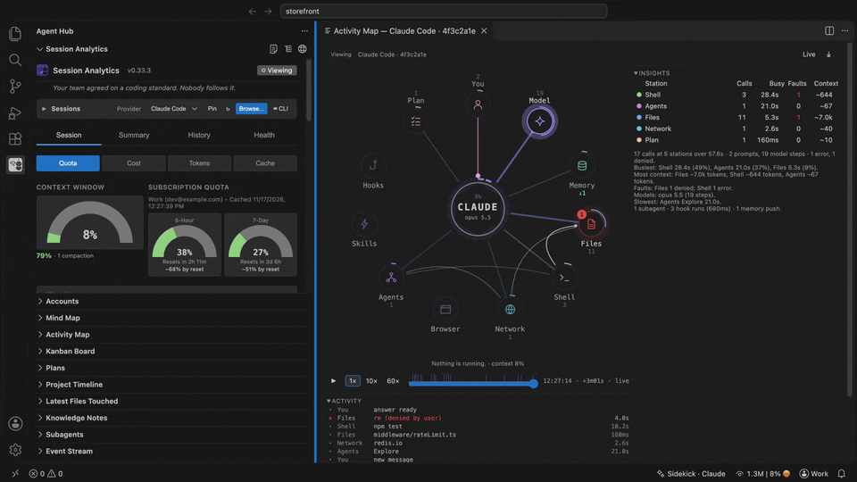
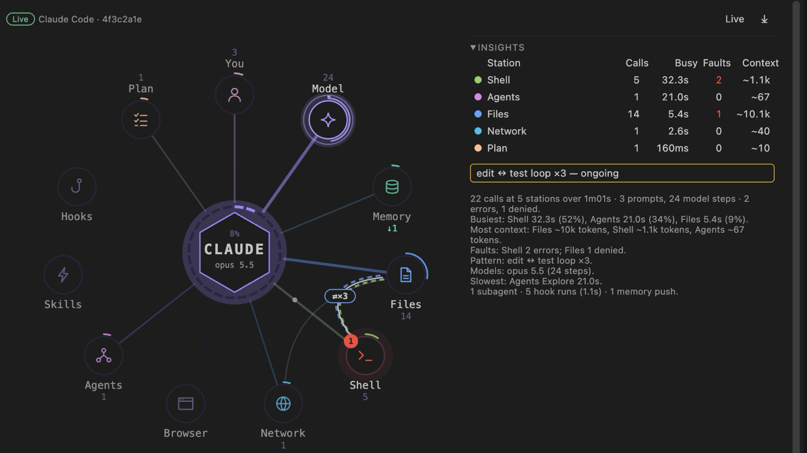
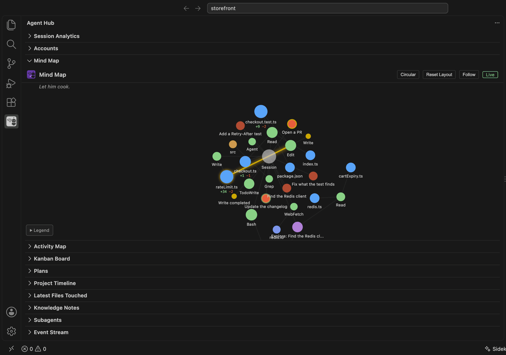
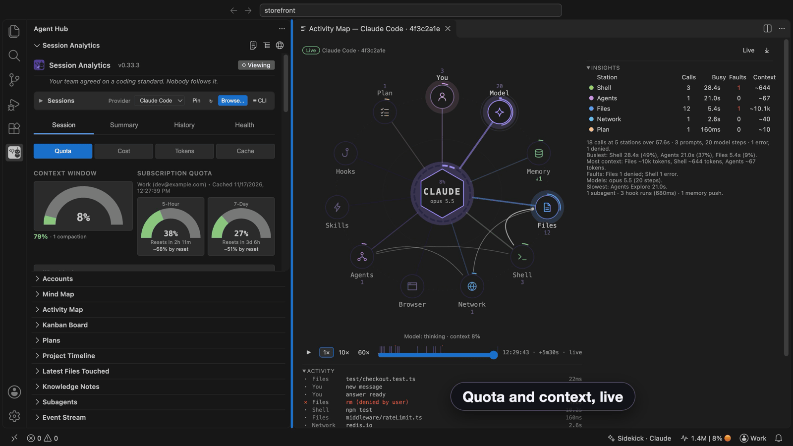
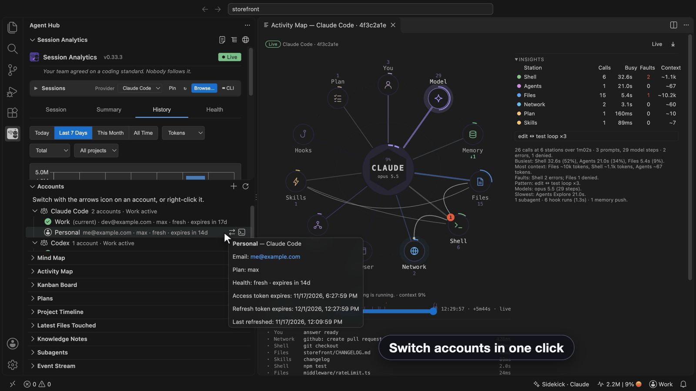
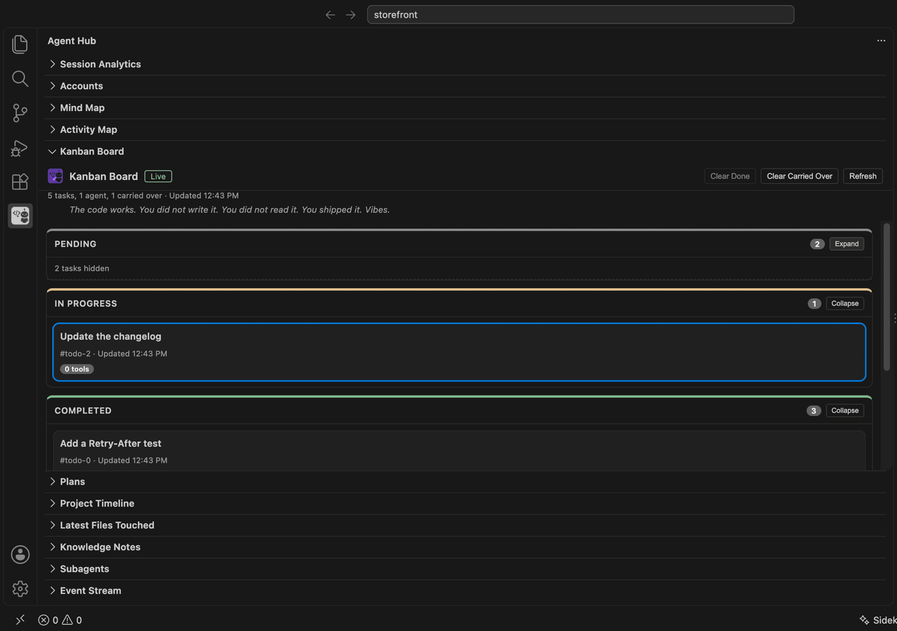
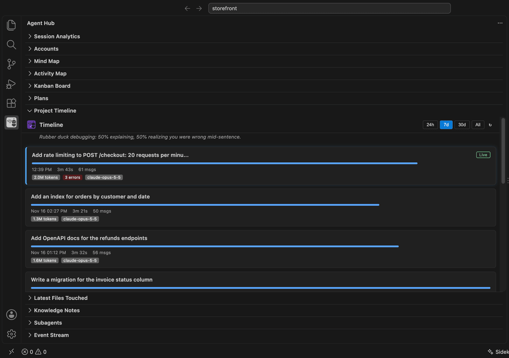
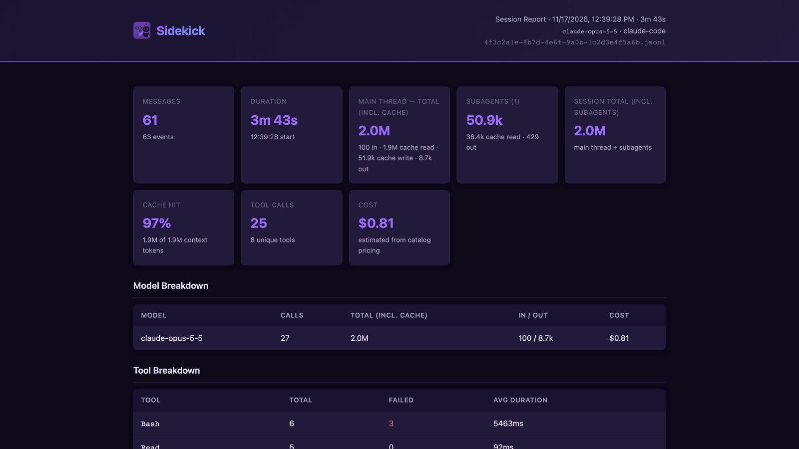
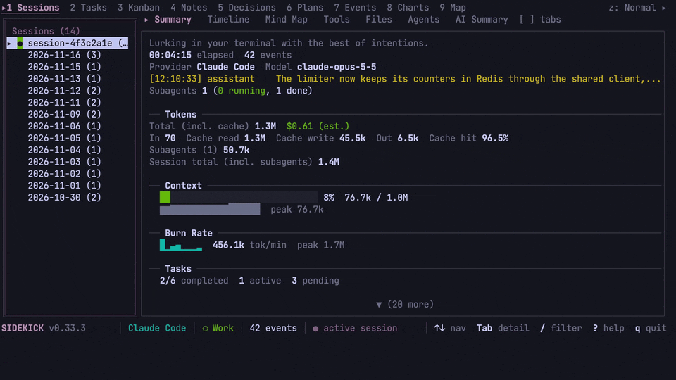

# Sidekick Agent Hub

**See what your AI coding agents are doing, and what they cost.** Live monitoring for Claude Code, Codex and OpenCode sessions in VS Code, with the same views in your terminal.



Coding agents work out of sight. Tokens burn in the background, the context window fills up without warning, and when a session ends, what it learned is gone. Sidekick reads the session files your agent already writes and shows you:

- **What it's doing**: every tool call, file and subagent, live, on an activity map.
- **What it costs**: tokens, cost, context fill, plan quota and five-hour billing blocks.
- **What to keep**: tasks, decisions, notes and a handoff for the next session.

Monitoring needs no proxy and no wrapper: keep running `claude`, `codex` or `opencode` as you do today, and open the **Agent Hub** icon in the activity bar.

| Provider                                                                                      | Inference | Session Monitoring | Cost                        |
| --------------------------------------------------------------------------------------------- | --------- | ------------------ | --------------------------- |
| **[Claude Max](https://cesarandreslopez.github.io/sidekick-agent-hub/providers/claude-max/)** | Yes       | Yes                | Included in subscription    |
| **[Claude API](https://cesarandreslopez.github.io/sidekick-agent-hub/providers/claude-api/)** | Yes       | —                  | Per-token billing           |
| **[OpenCode](https://cesarandreslopez.github.io/sidekick-agent-hub/providers/opencode/)**     | Yes       | Yes                | Depends on provider         |
| **[Codex CLI](https://cesarandreslopez.github.io/sidekick-agent-hub/providers/codex/)**       | Yes       | Yes                | ChatGPT plan or API billing |

## Quick Start

**Monitoring** needs nothing else: start a Claude Code, Codex or OpenCode session in your project and open **Agent Hub** in the activity bar. Sidekick finds the session and follows it live.

**AI features** (completions, transforms, commit messages and the rest) use an inference provider:

### [Claude Max](https://cesarandreslopez.github.io/sidekick-agent-hub/providers/claude-max/) (Recommended)

Works with any Claude plan that includes Claude Code: Pro, Max, or Ultra.

1. Install and authenticate Claude Code CLI:
   ```bash
   npm install -g @anthropic-ai/claude-code
   claude auth login
   ```
2. Install the extension from the [VS Code Marketplace](https://marketplace.visualstudio.com/items?itemName=CesarAndresLopez.sidekick-for-max) or [Open VSX](https://open-vsx.org/extension/cesarandreslopez/sidekick-for-max)
3. Press `Ctrl+K Ctrl+Shift+Space` (`Cmd+K Cmd+Shift+Space` on macOS) — the completion appears as ghost text

### [Claude API](https://cesarandreslopez.github.io/sidekick-agent-hub/providers/claude-api/)

1. Install the extension
2. Run **"Sidekick: Set API Key"** from the Command Palette
3. Set `sidekick.inferenceProvider` to `claude-api`

### [OpenCode](https://cesarandreslopez.github.io/sidekick-agent-hub/providers/opencode/)

1. Ensure OpenCode is running (`opencode` in a terminal)
2. Set `sidekick.inferenceProvider` to `opencode`

> **Note:** OpenCode session monitoring reads `opencode.db` and currently expects an executable `sqlite3` runtime in the host environment.

### [Codex CLI](https://cesarandreslopez.github.io/sidekick-agent-hub/providers/codex/)

1. Install Codex CLI: `npm install -g @openai/codex`
2. Run `codex login`, or set `OPENAI_API_KEY` / `CODEX_API_KEY`
3. Set `sidekick.inferenceProvider` to `codex`

## Features

### See what it's doing

- **[Activity Map](https://cesarandreslopez.github.io/sidekick-agent-hub/features/activity-map/)** — what the agent is doing, station by station: tool calls pulse to files, shell, network, memory, agents, hooks and more, with context fill, faults, subagents and the agent's route; open it in an editor tab to replay and scrub the session (or, with no live session, a recent one), with insights on where the time, errors and context went



- **[Mind Map](https://cesarandreslopez.github.io/sidekick-agent-hub/features/mind-map/)** — interactive D3.js graph of session structure and file relationships; the **Follow** toggle pans to new activity, or turn it off to stay put while you inspect



- **[Subagents Tree](https://cesarandreslopez.github.io/sidekick-agent-hub/features/session-monitor/#subagent-tree)** — one row per subagent spawn, from Claude Code (the `Agent` tool, formerly `Task`) or Codex (`spawn_agent`, labelled by nickname or task name), with nested parent/child relationships; background agents show as running until they finish, fail, or are stopped, an agent that ended cleanly without reporting shows "finished (no report)", and one in a session idle for more than 6 hours shows "ended"; each row shows the subagent's cache-inclusive token total and opens its transcript or Codex rollout on click. Codex subagents also appear in the dashboard and mind map
- **Analytics Charts** — tool frequency, frequent words in event summaries, activity heatmap, and event patterns in the dashboard
- **Event Stream** — live sidebar tree view of session events with color-coded type icons and timestamps
- **Conversation Viewer** — full session transcript that interleaves assistant reasoning, tool calls, and narration in provider-normalized arrival order (a compact Process + Answer shape) for Claude, Codex, and OpenCode; tool calls render as concise rows with expandable outputs, with search across the conversation
- **[Tool Inspector](https://cesarandreslopez.github.io/sidekick-agent-hub/features/tool-inspector/)** — per-tool rendering (diffs for Edit, commands for Bash, etc.) with paired tool outputs (file content, stdout, search results), plus the raw tool name and MCP server
- **Latest Files Touched** — sidebar tree of files the current session has read or modified
- **Notification Triggers** — alerts for credential access, sensitive-path writes, destructive commands, repeated tool errors, cycling without progress, compaction, token thresholds, and quota thresholds (once per reset window)
- **Provider Status** — live API health indicator scoped to the monitored provider: Claude for Claude Code sessions, OpenAI for Codex sessions, not shown for OpenCode sessions (use `sidekick status` in the CLI for a one-shot check)

### Know what it costs

- **[Session Analytics](https://cesarandreslopez.github.io/sidekick-agent-hub/features/session-monitor/)** — the session's context window, your plan's 5-hour and weekly quota with projections, cost, tokens and cache, the open five-hour billing block, a **History** tab (by day, model and tool, with a previous-period overlay and a project filter) and a **Health** tab with doctor checks



- **Accounts** — sidebar view of every saved Claude Code and Codex account grouped by provider with credential health, plus a status bar badge once an account is saved; switch, sign in again, open a terminal as an account, or undo from there. See [Account Switcher](https://cesarandreslopez.github.io/sidekick-agent-hub/features/account-switcher/)



### Keep the context

- **[Kanban Board](https://cesarandreslopez.github.io/sidekick-agent-hub/features/kanban-board/)** — task and subagent tracking with real-time updates; subagent cards say when an agent finished without a report, ended, failed, or was stopped, and **Clear Carried Over** removes tasks left from earlier sessions after asking



- **[Project Timeline](https://cesarandreslopez.github.io/sidekick-agent-hub/features/project-timeline/)** — chronological view of all sessions with duration, token usage, and expandable details



- **Plans** — agent plans discovered for the project, surfaced as a dedicated sidebar view
- **[Knowledge Notes](https://cesarandreslopez.github.io/sidekick-agent-hub/features/knowledge-notes/)** — capture gotchas, patterns, guidelines, and tips attached to files, with lifecycle tracking and instruction file injection
- **[Session Handoff](https://cesarandreslopez.github.io/sidekick-agent-hub/features/session-handoff/)** — automatic context documents for session continuity
- **[Decision Log](https://cesarandreslopez.github.io/sidekick-agent-hub/features/decision-log/)** — tracks architectural decisions from sessions
- **[HTML Session Report](https://cesarandreslopez.github.io/sidekick-agent-hub/features/session-monitor/)** — self-contained HTML report with full transcript, token/cost stats (including subagents), model breakdown, and tool-use summary — opens in a webview panel



- **Cross-Session Search** — search across all sessions
- **Extract Session Assets** — run `Sidekick: Extract Session Assets` to search recent Claude Code and Codex chats for URLs, files, commands, and plans. URLs open externally, file paths open in the editor, commands copy to the clipboard, and plans open as Markdown
- **[CLAUDE.md Suggestions](https://cesarandreslopez.github.io/sidekick-agent-hub/features/claude-md-suggestions/)** — AI-powered session analysis for optimizing agent instructions
- **[Event Logging](https://cesarandreslopez.github.io/sidekick-agent-hub/configuration/event-logging/)** — optional JSONL audit trail for debugging

### AI features

The extension can also do the mechanical work for you, through Claude Max, the Claude API, OpenCode or Codex:

- **[Inline Completions](https://cesarandreslopez.github.io/sidekick-agent-hub/features/inline-completions/)** — context-aware suggestions on request that understand your project, not just syntax (`Ctrl+K Ctrl+Shift+Space` to trigger)
- **[Code Transforms](https://cesarandreslopez.github.io/sidekick-agent-hub/features/code-transforms/)** — select code, describe changes in natural language (`Ctrl+K Ctrl+Shift+M`)
- **[Generate Documentation](https://cesarandreslopez.github.io/sidekick-agent-hub/features/generate-docs/)** — auto-generate JSDoc/docstrings from implementation, not just signatures (`Ctrl+K Ctrl+G`)
- **[Explain Code](https://cesarandreslopez.github.io/sidekick-agent-hub/features/explain-code/)** — five complexity levels from ELI5 to PhD Mode (`Ctrl+K Ctrl+E`)
- **[Quick Ask](https://cesarandreslopez.github.io/sidekick-agent-hub/features/inline-chat/)** — inline chat for questions and code changes (`Ctrl+K Ctrl+A`)
- **[AI Commit Messages](https://cesarandreslopez.github.io/sidekick-agent-hub/features/commit-messages/)** — generate meaningful messages from staged changes (sparkle icon in SCM toolbar)
- **[Pre-commit Review](https://cesarandreslopez.github.io/sidekick-agent-hub/features/code-review/)** — catch bugs, security concerns, and code smells before they reach your team (eye icon in SCM toolbar)
- **[PR Descriptions](https://cesarandreslopez.github.io/sidekick-agent-hub/features/pr-descriptions/)** — auto-generate structured summaries from branch diff (PR icon in SCM toolbar)
- **[Error Analysis](https://cesarandreslopez.github.io/sidekick-agent-hub/features/error-analysis/)** — AI explanations and fixes for any error or warning, in any language, from the lightbulb (`Ctrl+.`), the editor's Sidekick menu, or the Command Palette

## Terminal Dashboard

All monitoring and intelligence features are also available as a standalone terminal dashboard — no VS Code required.

> **Note:** The npm package is `sidekick-agent-hub`, but the binary is called **`sidekick`**.

```bash
npm install -g sidekick-agent-hub    # requires Node.js 20+ (22.15+ to read compressed Codex sessions)
sidekick dashboard
```



Browse sessions, tasks, decisions, knowledge notes, live event streams, charts, and the activity map in a full-screen TUI. Nine panels including an Events panel for real-time session activity, a Charts panel with tool frequency, event distribution, activity heatmap, and pattern analysis, and a Map panel with the live activity map and its insights. `sidekick map --follow` draws the map alone in any terminal split. Press `?` for keybindings. Standalone commands (`sidekick tasks`, `sidekick decisions`, `sidekick notes`, `sidekick stats`, `sidekick handoff`, `sidekick search`, `sidekick history`, `sidekick context`, `sidekick extract`, `sidekick quota`, `sidekick accounts`, `sidekick status`, `sidekick peak`, `sidekick today`, `sidekick doctor`, `sidekick statusline`, `sidekick blocks`, `sidekick daily`/`weekly`/`monthly`/`sessions`, `sidekick import`, `sidekick report`, `sidekick dump`, `sidekick map`) run one-shot queries without the TUI, and `sidekick mcp` serves read-only Sidekick facts over MCP stdio. See the [CLI Dashboard docs](https://cesarandreslopez.github.io/sidekick-agent-hub/features/cli/) for the full guide.

## [Key Settings](https://cesarandreslopez.github.io/sidekick-agent-hub/configuration/settings/)

| Setting                                           | Default        | Description                                                                                                                                                                                                 |
| ------------------------------------------------- | -------------- | ----------------------------------------------------------------------------------------------------------------------------------------------------------------------------------------------------------- |
| `sidekick.inferenceProvider`                      | `auto`         | Provider: `auto`, `claude-max`, `claude-api`, `opencode`, `codex`                                                                                                                                           |
| `sidekick.sessionProvider`                        | `auto`         | Session monitor: `auto`, `claude-code`, `opencode`, `codex`                                                                                                                                                 |
| `sidekick.inlineModel`                            | `auto`         | Model for completions (fast tier)                                                                                                                                                                           |
| `sidekick.transformModel`                         | `auto`         | Model for transforms (powerful tier)                                                                                                                                                                        |
| `sidekick.debounceMs`                             | `0`            | Delay before a triggered completion request is sent (ms)                                                                                                                                                    |
| `sidekick.commitMessageStyle`                     | `conventional` | Commit format: `conventional` or `simple`                                                                                                                                                                   |
| `sidekick.enableSessionMonitoring`                | `true`         | Enable agent session monitoring; changing it offers a reload, and while it is off, commands that need it offer **Enable Monitoring**                                                                        |
| `sidekick.accounts.keepAlive`                     | `false`        | Refresh saved-but-inactive accounts through the official CLIs after activation and every six hours                                                                                                          |
| `sidekick.accounts.autoSwitchThreshold`           | `0`            | Quota utilization percentage that triggers an automatic switch to a healthier saved account (`0` disables); Codex switches wait until Codex sessions are closed                                             |
| `sidekick.notifications.tokenThreshold`           | `5000000`      | Cache-inclusive session token total that triggers the high-usage warning                                                                                                                                    |
| `sidekick.notifications.triggers.quota-threshold` | `true`         | Alert when quota crosses `sidekick.notifications.quotaFiveHourThresholds` (`[80, 95]`; ignored on plans without a 5-hour limit, such as Ultra) or `sidekick.notifications.quotaSevenDayThresholds` (`[90]`) |
| `sidekick.claudePath`                             | `""`           | Full path to the `claude` CLI when it is not on PATH                                                                                                                                                        |
| `sidekick.autoHandoff`                            | `off`          | Session handoff: `off`, `generate-only`, `generate-and-notify`                                                                                                                                              |
| `sidekick.handoffUrlTemplate`                     | `""`           | External handoff URL template; placeholders `{sessionId}`, `{provider}`, `{projectPath}` — no transcript content is included                                                                                |
| `sidekick.pricing.hydrateFromLiteLLM`             | `true`         | Fetch model prices and context window sizes from LiteLLM on activation                                                                                                                                      |
| `sidekick.pricing.cacheTtlHours`                  | `24`           | LiteLLM catalog cache lifetime (hours)                                                                                                                                                                      |
| `sidekick.customModelPricing`                     | `{}`           | Your own per-model prices (USD per million tokens) for local models or negotiated rates; by default they win over the catalogs                                                                              |
| `sidekick.customModelPricingOnlyIfMissing`        | `false`        | Use custom prices only where no catalog has an exact price                                                                                                                                                  |
| `sidekick.peakHours.enabled`                      | `true`         | Show Claude peak-hours indicator in the dashboard and status bar (`claude-max` provider with Claude Code sessions)                                                                                          |
| `sidekick.peakHours.notifyOnTransition`           | `false`        | One-time toast when peak hours start or end (opt-in)                                                                                                                                                        |
| `sidekick.updateCheck.enabled`                    | `true`         | Notify when a newer Sidekick Agent Hub extension is published (checked after startup and twice a day)                                                                                                       |
| `sidekick.activityMap.motion`                     | `auto`         | Activity Map animation: `auto` follows VS Code's reduce-motion setting; `full`, `reduced`, or `none`                                                                                                        |
| `sidekick.activityMap.labels`                     | `names`        | Activity Map labels: `names` (names only), `descriptive` (adds the agent's short command descriptions, also in exports), or `none`                                                                          |

Model settings accept `auto` (recommended), a tier (`fast`/`balanced`/`powerful`), a legacy name (`haiku`/`sonnet`/`opus`), or a full model ID. Tiers resolve to current flagships — **Claude Opus 5.5** (`powerful`), **Sonnet 5.5** (`balanced`), and **Haiku 5.5** (`fast`) on Anthropic providers, and **GPT-6 Astra** (`powerful`), **GPT-6.1 Sol** (`balanced`), and **GPT-6 Luna** (`fast`) on Codex — with 1M-token context windows where available. Each request gets per-model thinking and effort settings (thinking off or low effort for completions and commit messages), and a literal `fable` selects Claude Fable 5.2 on the Claude API (Claude Max passes it to Claude Code). See [Model Resolution](https://cesarandreslopez.github.io/sidekick-agent-hub/configuration/model-resolution/) for details.

## Commands

| Command                       | Keybinding                | Description                                                                                                                                |
| ----------------------------- | ------------------------- | ------------------------------------------------------------------------------------------------------------------------------------------ |
| Toggle Inline Completions     | —                         | Enable/disable inline completions                                                                                                          |
| Trigger Completion            | `Ctrl+K Ctrl+Shift+Space` | Manually request completion                                                                                                                |
| Transform Selected Code       | `Ctrl+K Ctrl+Shift+M`     | Transform selected code                                                                                                                    |
| Quick Ask (Inline Chat)       | `Ctrl+K Ctrl+A`           | Inline chat                                                                                                                                |
| Generate Documentation        | `Ctrl+K Ctrl+G`           | Generate documentation                                                                                                                     |
| Explain Selected Code         | `Ctrl+K Ctrl+E`           | Explain selected code (five detail levels in the editor context menu)                                                                      |
| Explain Error with AI         | Lightbulb (`Ctrl+.`)      | Explain the error or warning at the cursor (five detail levels in the editor context menu)                                                 |
| Fix Error with AI             | Lightbulb (`Ctrl+.`)      | Generate a fix for the error or warning at the cursor and apply it from the panel                                                          |
| Generate Commit Message       | SCM sparkle icon          | AI commit message                                                                                                                          |
| Review My Changes             | SCM eye icon              | Pre-commit review                                                                                                                          |
| Generate PR Description       | SCM PR icon               | Auto-generate PR description                                                                                                               |
| Set API Key                   | —                         | Store the Claude API key for the `claude-api` provider                                                                                     |
| Test Connection               | —                         | Check local CLI readiness or an authenticated request for the current provider                                                             |
| Switch Inference Provider     | —                         | Change inference provider                                                                                                                  |
| Show Menu                     | Status bar item           | Quick pick of every Sidekick command                                                                                                       |
| Switch Account…               | `Ctrl+K Ctrl+Shift+A`     | Grouped quick pick of every saved account with health; also Add, Open Terminal, Sign In Again, Undo                                        |
| Add Account…                  | —                         | Sign in to another account in an isolated profile via the integrated terminal; the current login is untouched                              |
| Sign In Again to Account…     | Accounts view             | Re-authenticate an expired saved account in place, keeping its label and id                                                                |
| Open Terminal as Account…     | Accounts view             | Start a terminal whose `claude` / `codex` use a saved account without switching the live login (the live account opens in the normal home) |
| Undo Last Account Switch      | —                         | Revert the most recent switch                                                                                                              |
| Register Current Login        | —                         | Save the account you are signed in to right now                                                                                            |
| Remove Account…               | Accounts view             | Remove a saved account and its credentials                                                                                                 |
| Open Session Dashboard        | —                         | Open session analytics                                                                                                                     |
| Open Activity Map             | Activity Map view         | Open the activity map large in an editor tab, with insights and a replay bar                                                               |
| Export Activity Map…          | Activity Map view         | Save the map as SVG or the session's activity as JSON                                                                                      |
| Extract Session Assets        | —                         | Pick URLs, file paths, commands, or plans from recent sessions                                                                             |
| Search Across Sessions        | —                         | Full-text search over every session                                                                                                        |
| View Session Conversation     | —                         | Read the current session's transcript with search                                                                                          |
| Dump Session Report           | —                         | Export session data as text/markdown/JSON/HTML                                                                                             |
| Generate HTML Report          | —                         | Full transcript report in a webview panel                                                                                                  |
| Install Statusline            | —                         | Wire `sidekick statusline` into Claude Code's status line                                                                                  |
| Uninstall Statusline          | —                         | Restore the previous Claude Code `statusLine` block                                                                                        |
| Run Doctor                    | —                         | Cross-provider health diagnostics and the pricing basis; focuses the Health tab                                                            |
| Open External Session Handoff | —                         | Open the configured handoff URL for the active session                                                                                     |
| Browse Session Folders…       | —                         | Select session folder to monitor                                                                                                           |
| Check for Updates             | —                         | Check for a newer version of the extension now (Update, Release Notes, or Skip This Version)                                               |

Keybindings are shown for Windows/Linux; use `Cmd` in place of `Ctrl` on macOS (`Cmd+K Cmd+Shift+Space`, `Cmd+K Cmd+Shift+M`). Transform and Explain Selected Code require a selection; Explain Error and Fix Error use the error or warning at the cursor. Transform and Generate Documentation don't run in read-only editors. Requires VS Code 1.85 or later.

## Troubleshooting

**No completions?** Completions appear only when you ask for one: press `Ctrl+K Ctrl+Shift+Space` (`Cmd+K Cmd+Shift+Space` on macOS). If completions are off, the shortcut says so and offers **Turn On**, and the **Sidekick** status bar item shows a crossed-out circle. If the model had nothing to add, the status bar briefly reads "no suggestion here". Otherwise click the **Sidekick** status bar item and pick **Test Connection** (or run `Sidekick: Test Connection`) to verify provider connectivity.

**CLI not found?** Set `sidekick.claudePath` to the full path (find with `which claude`).

**OpenCode issues?** Ensure OpenCode is running and listening on port 4096. If session monitoring is still unavailable, verify `sqlite3` is executable in the same environment as VS Code because OpenCode session discovery reads `opencode.db`.

**Codex issues?** Verify `codex login status` shows you are logged in, or that `OPENAI_API_KEY` / `CODEX_API_KEY` is set.

**Request failed?** Inference failures name the problem — missing or rejected credentials, an expired OAuth sign-in, an invalid provider conversation, a service or connection failure, a timeout, rate limiting, an execution-policy denial, a missing runtime, or a context limit — with a recovery hint and a button for it, such as **Sign In Again**, **Set API Key**, or **Run Doctor**. Sidekick never signs in, changes credentials, switches providers, or replays a turn for you. When Transform Selected Code, Generate Commit Message, Review My Changes, Generate PR Description, Generate Documentation, or Quick Ask (Inline Chat) fails with a retryable error (such as a rate limit), the notification offers **Retry**, with the wait the provider asked for. "Test Connection" distinguishes local CLI readiness (Claude Max, Codex) from a successful authenticated request (Claude API), and a network or service error is not reported as a rejected key.

**Status card says unavailable?** The dashboard's public status card shows **Status unavailable** when the vendor status page could not be fetched, and **Incident information unavailable** when the feed omitted incidents. Details list every unresolved incident with its component associations and separate check and provider-update timestamps. A public incident does not establish the cause of a failed request, and an operational status page does not prove your connection works.

## Full Documentation

For detailed guides, configuration reference, and architecture docs, visit the [documentation site](https://cesarandreslopez.github.io/sidekick-agent-hub/).

## See Also

**[sidekick-shared](https://www.npmjs.com/package/sidekick-shared)** — the shared data access library, published as a standalone npm package. Types, parsers, session providers, event aggregation, model pricing, actionable session-asset extraction, and more — for building custom tools on Sidekick session data without depending on VS Code. Install with `npm install sidekick-shared`.

**[Sidekick Docker](https://github.com/cesarandreslopez/sidekick-docker)** — real-time Docker management dashboard as a [VS Code extension](https://marketplace.visualstudio.com/items?itemName=CesarAndresLopez.sidekick-docker-vscode) and [CLI](https://www.npmjs.com/package/sidekick-docker). Monitor containers, Compose projects, images, volumes, and networks with vi keybindings and live-streaming stats.

## Community

If Sidekick is useful to you, a [star on GitHub](https://github.com/cesarandreslopez/sidekick-agent-hub) helps others find it.

Found a bug or have a feature idea? [Open an issue](https://github.com/cesarandreslopez/sidekick-agent-hub/issues) — all feedback is welcome.

## License

MIT

Release notes are on the **Changelog** tab and in [CHANGELOG.md](https://github.com/cesarandreslopez/sidekick-agent-hub/blob/main/sidekick-vscode/CHANGELOG.md).
